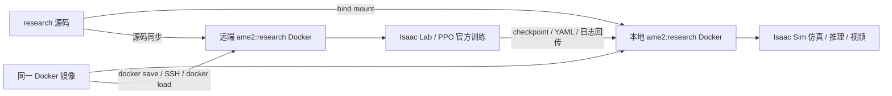

# AME-2 单镜像研究环境

这份手册对应 `research` 分支：同一个 `ame2:research` Docker 镜像在本地执行 Isaac Sim 仿真、检查点推理和录像，在 `tencent-231` 执行需要更多显存的 Isaac Lab 训练。源码、训练产物和镜像都有明确的同步路径；本地宿主机和服务器本体只承担 Docker、SSH、Git 和文件传输，不安装 Conda 或项目 Python 包。逐项功能、全部地形、图像和视频的复现记录见 [usage.md](usage.md)。

本仓库是 **Unitree G1 足式 locomotion** 项目，发布了普通 AME-2 teacher、主动 gaze teacher 及一个 gaze checkpoint。AM-Bench 的飞机与机械臂属于另一个项目；本手册沿用其配置与证据组织方式，覆盖本项目实际存在的机器人和场景。[上游 README](README.md) 明确尚未公开 neural mapping 权重、student 完整训练依赖、Tron1 环境和 neural map 训练代码，这些条目在 usage.md 单列。

## 1. 机器、目录与单镜像

| 位置 | 工作 | 持久目录 |
| --- | --- | --- |
| 本地 NVIDIA 16 GiB GPU | 小规模检查、官方 checkpoint 推理、Isaac Sim 录像、镜像构建 | 仓库根目录、`ame2/logs/`、`outputs/` |
| `tencent-231`，SSH 端口 22 | 在无计算进程且编号最小的 GPU 上训练 | `/diff/dzp_is_sb/ame2-research` |
| 两端 Docker | Isaac Lab 2.3.2 / Isaac Sim 5.1、仓库自带 `rsl_rl` 与 `ame2` | 同一个 `ame2:research` 镜像及各端 Docker 缓存卷 |



仓库提供的机器人 USD、mesh、Mid360 扫描方向和 gaze checkpoint 随源码保留。NVIDIA 基础镜像首次拉取较大，构建前检查本地和服务器 Docker 数据目录的剩余空间。所有下文宿主机命令都从仓库根目录执行；`/isaac-sim/python.sh` 只在 Docker 内使用。

```bash
git clone --branch research https://github.com/superboySB/ame2_minimal.git ame2-research
cd ame2-research
docker version
nvidia-smi
ssh -i ~/.ssh/id_ed25519 -o IdentitiesOnly=yes -o BatchMode=yes -p 22 tencent-231 'id -un'
```

已有 checkout 时跳过克隆，使用 `git switch research`。本次本机已有 `id_ed25519` 公钥被服务器接受，指定该 identity 的 `BatchMode=yes` 实测通过，无需重复写入服务器 `authorized_keys`。公钥登录配置保存在本机 SSH 文件和服务器 `authorized_keys` 中，不进入仓库。换一台本地机器时，可以使用已有公钥：

```bash
ssh-copy-id -i ~/.ssh/id_ed25519.pub -p 22 tencent-231
ssh -o BatchMode=yes -p 22 tencent-231 'id -un'
```

首次 `ssh-copy-id` 输入服务器登录凭据即可；后续自动化必须通过 `BatchMode=yes` 检查。

## 2. 构建并进入本地 Docker

```bash
IMAGE=ame2:research ./container/build.sh
IMAGE=ame2:research ./container/run.sh -g 0 shell
```

镜像固定基础版本 `nvcr.io/nvidia/isaac-lab:2.3.2@sha256:388dbc806f48359a964cb9f807feb226da95d0a107f470fdcad9780ea10fe6f2`。构建时将镜像中原有的 `rsl-rl-lib` 替换为本仓库的定制版，同时安装 `ame2`。代码使用 editable 安装，容器中的 `/workspace/ame2-minimal/ame2`、`/workspace/ame2-minimal/rsl_rl` 对应宿主机源码，因此 Python 修改同步生效；依赖或 Dockerfile 改动后重新构建并同步镜像。容器默认工作目录是 `/workspace/ame2-minimal/ame2`。

官方镜像内 `/workspace/isaaclab/VERSION` 为 `2.3.2`，其 Python distribution `isaaclab` 显示 `0.54.2`；这是两种版本标识，不能仅因 package version 不等于 `2.3.2` 就判断镜像错误。Torch 为 `2.7.0+cu128`。镜像内的 `image-packages.txt` 保存构建后的实际依赖清单。

首次构建发现 NVIDIA 镜像自带的新版 setuptools 与旧 packaging 不兼容。本分支 Dockerfile 在镜像内使用 `packaging==25.0` 并保留 Isaac 预打包环境的共享文件记录；普通 uninstall/upgrade 会误删 pip vendor 文件，因此使用已验收的 `--ignore-installed` 修复。用户只需重跑 build.sh，无需在宿主机安装或修补 Python。

容器内先确认运行环境和任务注册：

```bash
/isaac-sim/python.sh -c 'from importlib.metadata import version; print("ame2", version("ame2"), "rsl-rl-lib", version("rsl-rl-lib"))'
/isaac-sim/python.sh scripts/list_envs.py
```

应看到六个 `Ame2` 注册 ID；其中两个 student ID 的存在不代表缺失的 mapping 权重已经公开。最先验证 teacher，完整测试命令见 usage.md。

为了重复执行命令，可保持一个后台容器，然后通过 `docker exec` 进入：

```bash
./container/run.sh -g 0 --name ame2-research -d shell
./container/run.sh exec ame2-research
docker exec ame2-research /isaac-sim/python.sh scripts/list_envs.py
```

`cmd` 模式用于直接运行验证或其他容器内命令，例如 `./container/run.sh cmd /isaac-sim/python.sh scripts/list_envs.py`。`--dry-run` 输出实际 Docker 命令供检查。Isaac Sim 首次启动会生成 shader 和扩展缓存，第二次通常更快。每次测试保留完整日志，再根据退出码和报告判断是否通过。

## 3. 运行已有 gaze checkpoint

官方权重为 `modelzoo/g1_gaze_64000env_10h/model_2400.pt`，配套 YAML 在同一目录的 `params/` 下。权重目录只读挂载，本分支新增 `--output_dir` 将录像、JIT 导出和 PDF 写入可写目录：

```bash
IMAGE=ame2:research ./container/run.sh -g 0 play \
  --task Ame2-G1-Gaze-Play --num_envs 1 --seed 42 \
  --checkpoint /workspace/ame2-minimal/modelzoo/g1_gaze_64000env_10h/model_2400.pt \
  --output_dir /workspace/ame2-minimal/outputs/research/manual-stones \
  --terrain stones --difficulty 0.5 --video --video_length 800 --no_markers
```

`--video` 自动启用相机并在指定步数后退出；控制频率为 50 Hz，因此 800 步对应 16 秒仿真时间。真实运行速度取决于渲染和设备。视频输出到 `--output_dir` 下的 `videos/play/`；不指定时使用 `ame2/logs/rsl_rl/<experiment>/play/<时间戳>/`。连续录制为不同试次使用独立目录，避免覆盖。只需要有界推理而不录像时可以使用 `--max_steps 800`。

普通 teacher 使用 `Ame2-G1-Play`，gaze teacher 使用 `Ame2-G1-Gaze-Play`。checkpoint 必须匹配 actor 结构；官方 gaze 权重不能当作普通 AME-2 权重加载。teacher 观察的是仿真 privileged height scan；仅凭 teacher 在地形上行走不能证明真实激光 neural mapping 已经运行。

可选 GUI 使用同一张镜像：

```bash
test -n "$DISPLAY"
IMAGE=ame2:research ./container/run.sh -g 0 --gui play \
  --task Ame2-G1-Gaze-Play --num_envs 1 \
  --checkpoint /workspace/ame2-minimal/modelzoo/g1_gaze_64000env_10h/model_2400.pt \
  --terrain climb_up --difficulty 0.3 --max_steps 800
```

GUI 需要本地 X11 会话及容器获得该会话访问权限。没有桌面的服务器执行默认 headless 模式；需要观察动作时导出视频。`--vizacc` 只在 GUI 下启动实时髋关节加速度图，headless 模式会明确跳过。

## 4. 小规模训练、官方默认训练与原检查点配置

先用少量环境和迭代检查环境、rollout、PPO 更新和 checkpoint 写入。下面的短训练是功能检查，不能代替收敛模型：

```bash
IMAGE=ame2:research ./container/run.sh -g 0 train \
  --task Ame2-G1-Gaze --num_envs 64 --max_iterations 2 \
  --seed 42 --logger tensorboard --run_name smoke-gaze
```

训练产物写入 `ame2/logs/rsl_rl/ame2_gaze/<时间戳>_smoke-gaze/`，包括 `model_*.pt`、实际 `params/env.yaml`、`params/agent.yaml` 和 TensorBoard event。普通 teacher 将任务替换为 `Ame2-G1`，其实验目录为 `ame2`。

| 参数 | 当前源码 teacher 默认值 | 已发布 gaze checkpoint 的配套记录 |
| --- | --- | --- |
| 机器人 / 控制步长 | G1 / 0.02 s，物理步长 0.005 s，decimation 4 | 同类 G1 环境 |
| 环境数量 | 4096 / 进程 | `env.yaml` 为 16000 / 进程；运行名 `g1_gaze_4x16k`，modelzoo 说明合计 64000 |
| 训练迭代 | 5000 | `agent.yaml` 计划 3000，发布 `model_2400.pt` |
| 每次 rollout | 每环境 24 步 | 24 步 |
| 保存间隔 | 2000 次迭代 | 300 次迭代 |
| actor / critic | AME-2 或 gaze / 16 experts MoE | gaze：32 heads，crop 12 × 10 |
| 优化器 / 精度 | Muon / PPO 更新前向 bf16 | Muon / bf16 |
| PPO | 5 epochs、4 mini-batches、初始 LR 0.001，自适应 KL | 相同主要参数 |
| seed / logger | 42 / TensorBoard | 42 / WandB |

配套原始配置：[agent.yaml](modelzoo/g1_gaze_64000env_10h/params/agent.yaml)、[env.yaml](modelzoo/g1_gaze_64000env_10h/params/env.yaml)。目录名中的 `10h` 是上游运行说明；本分支重训所需时间以本次实际日志为准。

使用源码默认训练设置：

```bash
IMAGE=ame2:research ./container/run.sh -g 0 train \
  --task Ame2-G1-Gaze --num_envs 4096 --max_iterations 5000 \
  --seed 42 --logger tensorboard --run_name official-default-gaze
```

16 GiB 卡若无法承载 4096 环境，先降低 `--num_envs` 验证，正式训练使用远端空闲卡；减少环境会改变每次更新的 batch。多个 GPU 可用 `-g 0,1`，启动器自动使用 `torchrun` 和 `--distributed`；`--num_envs` 是每个 worker 的环境数，总量为 GPU 数乘以该参数。GPU ID 是宿主机编号，容器内会重新编号。

Hydra 可覆盖算法参数，例如 `agent.algorithm.optimizer=adam`、`agent.algorithm.use_mixed_precision=False`。Adam 和 Muon 的 checkpoint optimizer state 不兼容；改变优化器时开始新训练，推理仅加载模型权重不受此限制。关闭上身与脚姿态 shaping 可以覆盖 `env.rewards.ame2_optional_uppershaping.weight=0.0` 和 `env.rewards.ame2_optional_foot_shaping.weight=0.0`；上游注明这些 humanoid shaping 尚未针对 G1 调优。

## 5. 云端运行与同步规则

远端目录固定为 `/diff/dzp_is_sb/ame2-research`。本地构建镜像后同步同一镜像及源码，远端用 `docker load` 导入，无需在服务器安装 Isaac Lab、Python 包或 Conda。镜像转存包可能占用数十 GiB；传输前后同时核验 SHA-256 与 Docker image ID。代码同步保留远端日志，产物回传保留本地试次；重复实验使用新的 `--run_name`。

每次训练启动前重新查 GPU 进程，并选择**没有任何 GPU 进程的最小编号**。编号 1 只是可能的历史状态，不能固定假设它一直空闲。仅看利用率为 0% 或显存较少不能判定无人使用；如所有卡均有进程，等待空卡。远端 Docker 只暴露选中的 GPU。

```bash
ssh -o BatchMode=yes -p 22 tencent-231 \
  'nvidia-smi --query-gpu=index,uuid,memory.used,memory.total --format=csv; nvidia-smi --query-compute-apps=gpu_uuid,pid,process_name --format=csv'
```

部署同一镜像和源码：

```bash
./container/cloud.sh deploy
./container/cloud.sh status
./container/cloud.sh gpu
./container/cloud.sh run -d --name ame2-official-gaze train \
  --task Ame2-G1-Gaze --num_envs 4096 --max_iterations 5000 \
  --seed 42 --logger tensorboard --run_name official-default-gaze
```

`deploy` 先同步源码与 modelzoo，再传输镜像。`image` 在两端 image ID 相同时跳过传输；需要传输时，`.transfer/` 内使用压缩 Docker archive 和 SHA-256 校验，远端导入后再次比较 image ID。`push` 仅更新源码，保留两端日志与缓存；`pull` 回传 `ame2/logs/`、`outputs/`、`artifacts/` 和 `usage_assets/`。

```bash
./container/cloud.sh push
ssh -o BatchMode=yes -p 22 tencent-231 'docker logs --tail 100 ame2-official-gaze'
./container/cloud.sh pull
```

`cloud.sh run` 默认自动选卡，并用短时文件锁串行执行本项目的选卡和启动；`-g` 可以明确覆盖默认选择。筛选同时排除 `nvidia-smi` compute/pmon 中有计算或图形进程的 GPU、显存占用超过 512 MiB 的 GPU、被运行容器明确分配的 GPU。2026-10-10 探测中，GPU 1 虽无计算进程，但被 `php-parkour` 容器明确预留，因此当时最小可用编号是 2。已有 `--gpus all` 容器按实际进程占用判断，避免其“所有卡可见”设置封锁全部空闲设备。运行时的最终编号写入日志。

远端默认 shared memory 为 32 GiB，本地为 8 GiB。`CLOUD_HOST`、`CLOUD_PORT`、`CLOUD_ROOT`、`CLOUD_SHM_SIZE`、`CLOUD_CPUS` 和 `CLOUD_MEMORY_LIMIT` 可覆盖目标及资源；修改后用 `./container/cloud.sh --dry-run ...` 核对。源码改动不会隐式上传：先 `push`，再启动新训练。已有容器使用 bind mount，上传会影响其可见源码，应在独立试次之间同步。

需要同时记录完整命令、源码 SHA、每 2 秒 GPU 显存/利用率与退出状态时，使用 Docker 内训练作业脚本：

```bash
./container/cloud.sh run -d --name ame2-official-monitored cmd \
  /workspace/ame2-minimal/container/training_job.sh full new-full-trial
```

脚本拒绝同名证据目录，`new-full-trial` 每次替换为新的运行标记。产物目录为 `outputs/research/reproduce-20261010/cloud_<标记>/`；checkpoint 在 `ame2/logs/rsl_rl/research_official_full/`。`full` 保持默认的 Gaze 环境、4096 env、5000 iterations、seed 42 和优化器，仅把 checkpoint 保存间隔改为 200，便于中途恢复与审计。默认算法参数与原 64000 环境 checkpoint 的差别见第 4 节。

| 阶段 | 内容 |
| --- | --- |
| `matrix` | 普通 / gaze × Muon+bf16 / Adam+fp32，以及单 value head 对照 |
| `resume` | 从 matrix 的 gaze Muon `model_2.pt` 恢复 2 次更新，核验 optimizer state |
| `benchmark` | 官方默认 4096 env / 完整 600 tile，10 次更新 |
| `full` | 官方默认 4096 env，5000 次更新及 checkpoint / TensorBoard 审计 |
| `ddp` | 两个已核实空闲的 GPU，每卡 64 env，3 次更新；需容器显式暴露两张卡 |
| `audit` | 对已生成 matrix / resume checkpoint 与训练 event 做有限值审计 |

## 6. 恢复训练、日志和故障定位

恢复同一算法配置的训练时明确指定运行目录与权重文件：

```bash
IMAGE=ame2:research ./container/run.sh -g 0 train \
  --task Ame2-G1-Gaze --num_envs 4096 --max_iterations 5000 \
  --resume --load_run '<原运行目录名>' --checkpoint model_2000.pt \
  --seed 42 --logger tensorboard --run_name resumed-gaze
```

`--max_iterations` 是这次 runner 继续执行的迭代数量，恢复前查看现有 checkpoint iteration 与训练目标。`--load_run` 按同一个 experiment 目录查找；普通 teacher 与 gaze teacher 使用不同目录。实际配置以每次产物中的 YAML 为准。

| 现象 | 检查与处理 |
| --- | --- |
| Docker 看不到 GPU | 先检查宿主 `nvidia-smi`、Docker NVIDIA runtime 与 `docker run --gpus`，再启动 Isaac |
| 官方基础镜像或素材下载失败 | 保留拉取/启动日志，检查 NVIDIA registry 和 Isaac 资产服务网络，恢复后重试原命令 |
| CUDA OOM | 本地检查降至 1 个推理环境或 64 个训练环境；大训练转到远端空闲 GPU |
| 普通 teacher 加载 gaze 权重出现 key/shape 错误 | 改用 `Ame2-G1-Gaze-Play`，普通 teacher 使用其自身训练产物 |
| 视频、JIT、PDF 写入报只读错误 | 使用本分支 `--output_dir` 指定可写目录，保持 modelzoo 权重只读 |
| Student 报 neural mapping model 不存在 | 对照第 7 节；当前公开仓库缺权重，不能通过安装 Python 包解决 |
| 仿真进程持续运行 | 原始 zero/random/play 入口没有默认步数上限；使用有界验证脚本或 `--video --video_length` |

## 7. 尚未公开的功能

Student 的代码入口已经注册，但需要以下文件：

- `ame2/ame2/NN_models/g1LivoxMapping_perframe.pt`：Mid360 每帧 neural mapping TorchScript；上游尚未提供。
- `ame2/ame2/NN_models/g1_gaze_teacher_isaaclab.jit`：冻结 teacher JIT，可从已发布 gaze checkpoint 导出，再复制到该位置。

仅导出 teacher 不足以运行 student；缺失 mapping 权重时传感器初始化会抛出明确的 `FileNotFoundError`。LiDAR 可视化、neural map uncertainty、LSIO imitation + RL 的完整验证依赖同一缺失权重。Tron1、depth neural map 与 mapping 训练代码仍在上游 release plans 中。本分支保留这些边界，不用伪造模型或替代地图把它们记作论文功能复现。

容器内可在启动 Isaac 前核验缺失依赖；此命令在文件缺失时返回 exit code 2，并生成报告：

```bash
/isaac-sim/python.sh scripts/research/inventory.py \
  --preflight_task Ame2-G1-Gaze-Student --output logs/research/student_preflight.json
```

基础版本和 NVIDIA 容器配置可交叉参考 [NGC Isaac Lab 2.3.2 镜像](https://catalog.ngc.nvidia.com/orgs/nvidia/-/containers/isaac-lab/2.3.2) 与 [Isaac Sim 5.1 官方容器指南](https://docs.isaacsim.omniverse.nvidia.com/5.1.0/installation/install_container.html)。项目功能边界以本仓库 README、实际注册和本次验收报告为准。
