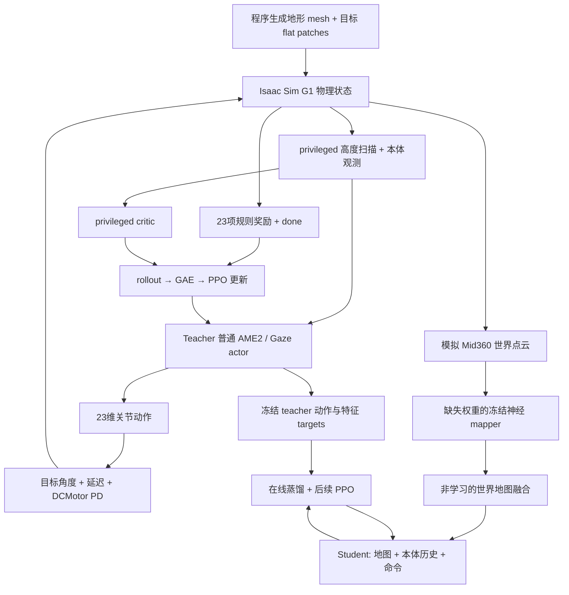

# AME-2 G1：输入输出、学习信号与 real→sim→real 实现

本文解释当前 `research` 分支的实际代码与数据契约。安装和运行命令见 [note.md](note.md)，实测结果、图像和视频见 [usage.md](usage.md)。本文独立新增，不修改 README。

**已经跑通的主路径是 G1 的仿真 teacher 训练与推理。** 本次单卡 4096 环境的 gaze teacher 已完成 5000 次 fresh 更新，末迭代 4999，[终态监控](usage_assets/diagnostics/full_completed_training/monitor_result.json)与[checkpoint / TensorBoard 审计](usage_assets/diagnostics/full_completed_training/checkpoint_audit.json)通过；[最终权重、实际配置与来源](modelzoo/g1_gaze_research_4096env_5000/provenance.json)随 Git 提供，策略表现另见 [usage.md](usage.md#3-两种-teacher-训练)。Student 的网络、蒸馏和 LiDAR 地图接口存在，但其神经建图权重未发布；真实 G1 驱动、LIO 和真机控制程序也不在本仓库。因此，本仓库提供了 real→sim→real 的部分组件，不能据此声称已经完成真机闭环。

## 1. 先看完整数据流

这里的任务是：给 G1 一个地形上的目标位置与朝向，让它通过关节控制走到目标并站稳。它不是速度命令跟踪任务。注册任务只有 G1，`--fly` 是对机器人施加外力的仿真调试功能，没有飞机策略。



图中 teacher 路径直接使用仿真地形扫描，**不经过 Mid360 或 neural mapper**。Student 路径需要额外的未发布 mapper，图示表示代码的连接关系，不表示这条路径已通过端到端验收。[任务注册](ame2/ame2/tasks/__init__.py)、[环境配置](ame2/ame2/tasks/ame2_env_cfg.py)、[训练入口](ame2/scripts/rsl_rl/train.py)。

下文 `B` 表示环境/样本 batch；位置为 m，角度为 rad，速度为 m/s 或 rad/s；四元数为 Isaac 的 `wxyz`。默认 physics 为 **200 Hz**，策略为 **50 Hz**，完整回合时长上限为 16 s，即 800 个策略步；提前终止与训练首回合的随机计数例外见第 4.2 节。训练 tensor 与 rollout storage 默认 FP32、位于 GPU；BF16 只覆盖更新中的部分计算。

## 2. 强化学习的状态与观测

物理状态包括机器人位置、姿态、全部关节、接触、地形和环境计数等。Actor 只看到下面的有限观测；critic 得到更多仿真信息，也不是把完整物理状态原样输入。二者不能混称为同一个“state”。

### 2.1 Teacher actor 的输入

普通与 Gaze teacher 使用相同的两个 named tensor，合计 1252 个标量，网络分别编码它们：

| 输入名 | shape | 内容 |
| --- | --- | --- |
| `teacher_prop` | `[B,82]` | 本体 78 维 + 目标命令 4 维 |
| `teacher_mapping` | `[B,26,15,3]` | yaw 对齐局部网格，每格 `(x,y,z)` |

`teacher_prop` 的半开切片顺序如下。训练噪声是逐元素加性 uniform，表中给半宽；普通 PLAY 关闭这些框架观测噪声。

| 切片 | 观测 | 坐标/含义 | 默认训练噪声 |
| --- | --- | --- | --- |
| `0:3` | base linear velocity | 完整 root 姿态的 body frame | ±0.1 m/s |
| `3:6` | base angular velocity | root body frame | ±0.2 rad/s |
| `6:9` | projected gravity | 世界单位重力投影到 body，站直约 `(0,0,-1)` | ±0.05；加噪后不再归一化 |
| `9:32` | joint position | `q-q_default` | ±0.01 rad |
| `32:55` | joint velocity | `qdot-qdot_default`，默认速度为零 | ±1.5 rad/s |
| `55:78` | action history | `clip(action_manager.prev_action,-50,50)` | 无 |
| `78:82` | commands | `(goal_x,goal_y,sin(yaw_error),cos(yaw_error))` | 见下面的内部随机化 |

目标 xy 使用仅 yaw 的局部坐标系；它与完整姿态 body velocity 的坐标变换不同。目标距离超过 2 m 时，actor 将 xy 长度截到 2 m，并**每次观测调用重新随机化 yaw**；critic 保留完整 xy 和真实 yaw。该函数内部随机化不受 `enable_corruption=False` 控制。[观测实现](ame2/ame2/tasks/mdp/observations.py#L248)、[组装顺序](ame2/ame2/tasks/ame2_env_cfg.py#L242)。

命令还有框架时序边界：每次 `step()` 先推进物理、计算终止与奖励，再 reset、更新相对目标命令，最后生成返回观测；因此正常步返回的 actor/critic 命令已更新，但本步奖励读的是更新前缓存。显式 `env.reset()` 只重采样 world goal，没有调用相对命令更新；初次构造环境时 raw body-command 缓存为零，对应上述四维 actor 命令 `(0,0,0,1)`，首个 step 结束才更新。之后再次显式 reset 也可能暂读旧缓存；step 内自动 reset 则会在生成返回观测前更新。部署或复刻首帧时不能假定显式 reset 已把相对命令算好。此顺序来自固定镜像内 `isaaclab/envs/manager_based_rl_env.py`、`manager_based_env.py` 与 `envs/mdp/commands/pose_2d_command.py`。

动作历史还存在一个容易遗漏的时间偏移：接受 `a_t` 时框架先执行 `prev_action←action`、`action←a_t`，物理步结束后才生成新观测。因此，执行 `a_t` 后返回的观测包含 `a_{t-1}`；选择下一动作时，它并不是刚刚执行的 `a_t`。部署时应复制实际训练契约，不能凭“last action”名称猜测。

### 2.2 Teacher 地图的数据格式

网格 x 为 `[-0.5,1.5]`、26 格，y 为 `[-0.56,0.56]`、15 格，分辨率 0.08 m。张量先 x 后 y；展平时 y 变化最快。扫描跟随 base yaw，仅与 `/World/ground` 求交。

```text
z = ray_hit_world_z - raycaster.data.pos_w_z + 0.74
teacher_mapping[b,i,j] = (x_i, y_j, z_ij)
```

0.74 m 是观测高度基准，不是默认 root 初始高度 0.78 m。扫描起点的 20 m offset 用于向下射线，不能在上式再额外减 20 m。无效命中以最低有效高度加每环境 `U(-1.5,-0.65)` m 填洞；全无效时最低值回退 -10 m。先 clip z 到 `[-1.5,1.5]`，再加每格 custom noise，默认半宽 `(0.001,0.001,0.05)` m，因此最后高度可能略超出这个 clip 范围。[地图构造](ame2/ame2/tasks/mdp/observations.py#L120)。

训练扫描 reset drift 为 ±0.04 m；输入 xy 仍是名义网格。PLAY 关闭 drift 和组级 corruption，**但并没有关闭函数内部 custom noise 或远目标 yaw 随机化**。Student 的 teacher-target 配置另行将 custom noise 置零。[PLAY 覆盖](ame2/ame2/tasks/ame2_env_cfg.py#L735)、[student teacher 配置](ame2/ame2/tasks/ame2_env_cfg.py#L806)。

### 2.3 Critic 的 499 维输入

| 切片 | 内容 |
| --- | --- |
| `0:78` | 与 teacher 本体项目同序，无观测噪声 |
| `78:82` | 未截断距离、未随机化 yaw 的真实目标命令 |
| `82:83` | 剩余时间 `1-episode_length_buf/800` |
| `83:109` | 26 个接触状态 |
| `109:499` | 独立 privileged height scan，390 个 z |

接触状态取最近 4 个 physics 帧的最大接触力模长是否超过 1 N，按默认质量 `>0.1 kg` 和 ignore 名单筛选 body。它不是单帧足底接触，26 个 body 包含 base、躯干、头、腿和手臂。Critic 地图无效格使用最低有效高度减 10 m 填充，再 clip 到 `[-1.5,1.5]`；配置中声明的 noise 因 critic corruption 关闭而不实际加入。[critic 配置](ame2/ame2/tasks/ame2_env_cfg.py#L183)、[接触实现](ame2/ame2/tasks/mdp/observations.py#L306)。

当前 teacher actor/critic 的 `update_normalization()` 为空操作，没有隐含的 running mean/std 标准化。[模型实现](rsl_rl/rsl_rl/models/AME2_models.py)。

## 3. 动作、关节顺序与底层控制

Actor 输出高斯分布的均值 `mu[B,23]`，每个关节有可学习、与状态无关的 `log_std[23]`。训练从 `Normal(mu,exp(log_std))` 采样；推理取均值。没有 tanh 或默认 `[-1,1]` 限制，23 维动作不是力矩。

```text
q_des = clip(q_default + 0.25 * action, -100, 100)  # rad
tau_computed = Kp*(q_des-q) + Kd*(qdot_des-qdot) + tau_ff
tau_applied = motor_torque_speed_clip(tau_computed, qdot)
```

Clip 在 scale/offset **之后**。默认只写位置目标，速度目标与前馈力矩为零。DCMotor 模型再根据 effort limit 和速度相关 torque-speed 曲线限幅。[动作配置](ame2/ame2/tasks/ame2_env_cfg.py#L169)、[延迟动作实现](ame2/ame2/tasks/mdp/actions.py)。Scale/clip 与 PD 的框架实现分别位于 Docker 的 `isaaclab/envs/mdp/actions/joint_actions.py`、`isaaclab/actuators/actuator_pd.py`。

实际关节顺序如下，名称末尾均为 `_joint`，不能替换为按整条左右腿排列的顺序：

| index | 关节 | `q_default` rad |
| --- | --- | --- |
| 0,1 | left_hip_pitch, right_hip_pitch | -0.30, -0.30 |
| 2 | waist_yaw | 0 |
| 3,4 | left_hip_roll, right_hip_roll | 0, 0 |
| 5 | waist_roll | 0 |
| 6,7 | left_hip_yaw, right_hip_yaw | 0, 0 |
| 8 | waist_pitch | 0 |
| 9,10 | left_knee, right_knee | 0.62, 0.62 |
| 11,12 | left_shoulder_pitch, right_shoulder_pitch | 0.35, 0.35 |
| 13,14 | left_ankle_pitch, right_ankle_pitch | -0.33, -0.33 |
| 15,16 | left_shoulder_roll, right_shoulder_roll | 0.16, -0.16 |
| 17,18 | left_ankle_roll, right_ankle_roll | 0, 0 |
| 19,20 | left_shoulder_yaw, right_shoulder_yaw | 0, 0 |
| 21,22 | left_elbow, right_elbow | 0.30, 0.30 |

顺序来自实际导出的 [IO YAML](usage_assets/diagnostics/IO_descriptors.yaml) 并与 [symmetry 代码](ame2/ame2/tasks/mdp/symmetry.py#L85) 一致。该 YAML 的 `observations: {}` 为空，不能把它当作完整部署输入 schema。

每策略步执行 4 个 5 ms 物理步。`delay_range=(0,1)` 的 history 在每次物理 substep 推进，所以默认动作延迟为 **0 或 5 ms**；不是 0 或 20 ms。PLAY 为零延迟。当前仿真 PD 为 200 Hz；不能套用论文真机的 400 Hz。

主要电机参数由 [unitree.py](ame2/ame2/assets/unitree.py#L49) 定义：

| 关节组 | Kp | Kd | effort limit Nm | velocity limit rad/s |
| --- | --- | --- | --- | --- |
| hip pitch/yaw、waist yaw | 88 | 2 | 88 | 32 |
| hip roll | 139 | 3 | 88 | 32 |
| knee | 139 | 3 | 139 | 20 |
| waist roll/pitch | 50 | 1 | 50 | 37 |
| ankle pitch/roll | 35 | 0.8 | 50 | 37 |
| shoulder pitch | 35 | 0.8 | 25 | 37 |
| shoulder roll/yaw、elbow | 40 | 1 | 25 | 37 |

Motor saturation effort 为表中 effort 的 1.25 倍；armature 也在配置中显式指定。真实硬件必须核对版本、关节零位、符号、增益与限幅，USD 的名字本身不足以证明这些参数适合任意 G1。

## 4. 奖励、终止与任务采样

### 4.1 23 项奖励及 label 来源

所有奖励由模拟状态、接触与规则函数在线计算，**没有人工 reward label 文件**。设 `f_k` 为下表原始函数输出，控制步长 `dt=0.02 s`，实际 transition 的第 k 项奖励为：

```text
r[t,k] = dt * weight[k] * f_k(physics_after_action, command_cache, action, history)
scalar_reward[t] = sum_k r[t,k]
```

奖励在物理步后、reset 和本步 command 更新前计算，输入并非全来自同一时刻：速度、接触、关节与递增后的回合计数来自本步物理结果；前四项的 `d/psi/goal_xy` 则直接读相对命令缓存，在常规连续 step 中对应动作前状态，约滞后 20 ms。显式 reset 的缓存例外见第 2.1 节。`weight=-500` 的早停项激活一次实际贡献 -10，而不是 -500。Teacher 默认有 23 个 value head，顺序正是下面的奖励顺序；**23 个 head 与 23 个动作是两个不同概念**。[奖励配置](ame2/ame2/tasks/ame2_env_cfg.py#L413)、[奖励实现](ame2/ame2/tasks/mdp/rewards.py)。

记 `I` 为条件指示函数，`[x]+ = max(x,0)`，`d` 为平面目标距离，`psi` 为 heading error，`t_left` 为剩余秒数。

| k | 配置名 | weight | 原始函数 `f_k` |
| --- | --- | --- | --- |
| 0 | `ame2_position_tracking` | 100 | `I(t_left<4)/(4*(1+(d/2)^2))` |
| 1 | `ame2_heading_tracking` | 50 | `I(t_left<2)*I(d<0.5)/(2*(1+psi^2))` |
| 2 | `ame2_move2goal` | 5 | 已在 0.5 m 内，或速度与目标夹角 cos>0.5 且速度模长在 `[0.3,2]` m/s，满足则 1；v 取 torso world 线速度经 root 完整 quat 转 body，goal_xy 却是 yaw-only frame |
| 3 | `ame2_standatgoal` | 5 | `I(d<.5且abs(psi)<.5)*exp(-(d_foot+1-g_z^2+mean(abs(q-qdef))+d)/4)`；`d_foot` 为两足未接触比例 |
| 4 | `early_termination_penalty` | -500 | 非 timeout 时激活的 `early_*` 项数，可同时多项 |
| 5 | `undesired_spinning` | -1 | head 世界 z 角速度绝对值 >3 rad/s |
| 6 | `undesired_leaping` | -1 | 4 帧中曾两足同时离地、raw 地形高度跨度 <0.3 m、且 t≥0.2 s |
| 7 | `undesired_non_foot_contacts` | -1 | 选中 body 的 history 接触指示之和 + first-contact 指示之和，新接触可计两次 |
| 8 | `undesired_stumbling` | -1 | `sum I(max_history(norm(Fxy)) > 1.1*max_history(Fz)+1N)`；不是只检查足 |
| 9 | `undesired_slippage` | -1 | `sum I(current_contact_time>.025s 且 world_xy_speed>.3m/s)` |
| 10 | `undesired_self_col_knee` | -1 | 左右膝 filtered 接触力 history 最大值 >1 N 的计数 |
| 11 | `undesired_self_col_torso` | -1 | torso 与肩/肘/wrist 的 filtered 自碰撞计数 |
| 12 | `undesired_self_col_ankle` | -1 | 左右 ankle_roll 的 filtered 自碰撞计数 |
| 13 | `base_roll_rate` | -0.1 | torso frame `omega_x^2` |
| 14 | `joint_regularization` | -0.001 | `sum(qdot^2)+.01*sum(applied_tau^2)+.001*sum(qddot^2)` |
| 15 | `action_smoothness` | -0.01 | `sum((raw_action-prev_action)^2)`，无除 dt |
| 16 | `link_contact_forces` | -1e-5 | `sum([min(mean_history(norm(F)),800)-400]+^2)`；400/800 阈值单位 N，原始惩罚单位 N² |
| 17 | `body_lin_acc_l1` | -0.001 | 默认质量 ≥0.1 kg 的 body 世界加速度 **L2 模长之和**，名字中的 l1 不是逐 xyz 绝对值和 |
| 18 | `joint_pos_limits` | -1000 | `sum([q-.95*qmax_hard]+ + [.95*qmin_hard-q]+)` |
| 19 | `joint_vel_limits` | -1 | `sum([abs(qdot)-.9*velocity_limit]+)` |
| 20 | `joint_torque_limits` | -1 | `sum([abs(applied_tau)-.8*effort_limit]+)` |
| 21 | `ame2_optional_uppershaping` | -1 | 8 个 arm joint 的 `(q-qdef)^2` 和；raw 高度跨度 <0.3 m 时乘 1，否则乘 0.1 |
| 22 | `ame2_optional_foot_shaping` | -1 | `sum_feet(wrap_to_pi(yaw_foot-yaw_torso)^2)*(.1+.9*I(abs(root_lin_vel_b.x)>.3))` |

实体筛选、history 聚合和阈值应以源码为准：例如 stumbling/slippage 不限足，contact-force 的 400 N 不随质量随机化改变。`body_lin_acc` 由位置差分得到速度、再差分得到加速度，reset 后前两次差分置零；不是直接真实 IMU 读数。[加速度实现](ame2/ame2/tasks/mdp/acceleration.py)。

### 4.2 什么时候 done

到达目标不会立即结束，策略需要继续站到超时或其他终止条件。默认终止如下：[配置](ame2/ame2/tasks/ame2_env_cfg.py#L573)、[实现](ame2/ame2/tasks/mdp/terminations.py)。

| 条件 | 实际规则 |
| --- | --- |
| timeout | 回合计数达到 800 个策略步，完整回合上限 16 s；训练首次回合有随机计数例外 |
| gravity | t≥0.2 s，且 `abs(gx)>.985`、`abs(gy)>.7`、`gz>0` 任一成立 |
| hip acceleration | t≥1 s，任一 hip_pitch 世界竖直加速度 `abs(az)>100 m/s²`，且同侧足最近 4 帧有接触 |
| illegal contact | t≥1 s，torso 或 pelvis_contour 的 history 平均力模长 >400 N |
| stagnation | 每 5 s 检查相邻快照：root 三维净位移 <0.5 m 且目标平面距离 >1 m |

环境返回的 `terminated` 和 `truncated` 共同进入 RSL `dones`；timeout 另外放入 extras。Done 环境在返回 observation 前已经 reset，不能把返回的初始状态当成 terminal observation。

训练入口调用 `learn(..., init_at_random_ep_len=True)`，将首次 `episode_length_buf` 随机设为 `0..799`，所以第一次 timeout 可能在实际 rollout 的第 1 至 800 步到来；后续正常 reset 从 0 计数。Stagnation 的目标距离同样读取本步更新前的命令缓存。[训练调用](ame2/scripts/rsl_rl/train.py#L276)、[初始计数](rsl_rl/rsl_rl/runners/on_policy_runner.py#L63)、[stagnation](ame2/ame2/tasks/mdp/terminations.py#L220)。独立推理评估不做这项训练计数随机化；新增首回合指标在 reset 前直接用 world goal/root pose 重算距离和 heading，见 [episode_metrics.py](ame2/scripts/research/episode_metrics.py)。

### 4.3 地形、目标与课程

默认地形是 10×60 个 12×12 m tile，共 600 个；并非每个环境独立生成一张 600-tile 地图。16 种生成器中 12 种有训练采样权重，`pit/peak/test_1/test_2` 权重为零；各类型的实测视频见 usage。[地形配置](ame2/ame2/tasks/terrains.py)。

目标从该 level/type 的有效 flat patches 中抽样，优先在相对 `env_origin` 的世界前锥内；无候选时回退任意有效 patch。目标 z 加默认 root 高度；world heading 从 `[-pi/3,pi/3]` 抽取，并不自动朝向目标。Flat patches 和 goal 是程序几何结果，不是人类动作示范标签。[目标采样](ame2/ame2/tasks/mdp/commands.py)。

默认课程在 reset 时更新：terrain 依据目标距离及 EMA 升降级，这里的距离也是 command 更新前的缓存，并非重算本步 terminal pose 的精确距离；另外在 `24*2000=48000` 个公共策略步内，将初始 yaw 从 0 扩到 ±pi、goal cone 从 10° 扩到 45°、地图 z noise 从 0 扩到 0.05 m。该计数不是所有并行环境的样本总和。[课程实现](ame2/ame2/tasks/mdp/curriculums.py#L175)。

## 5. 网络内部怎么从观测变成动作

### 5.1 普通 teacher

`MLP_512` 表示两层宽度 512 的 ELU 隐藏层，不是 512 层。

```text
map XYZ → 每格 FC 3→16 ┐
map Z   → CNN 1→8→48  ┴→ concat64 → Linear96 → 390个96维token
tokens → 每格MLP 96→64→64 → spatial max → global64
prop82 → MLP_512 → prop128
[prop128,global64] → MLP_512 → query96
query + 390个token → 32-head attention → local96
[local96,prop128,global64] → MLP_512 → action_mean23
```

Attention embed dim=96，每 head 为 3 维。CNN、FC 和 attention 都通过策略 loss 学习，没有单独的地形类别监督。[编码器](rsl_rl/rsl_rl/models/AME2_models.py#L48)、[forward](rsl_rl/rsl_rl/models/AME2_models.py#L137)。

### 5.2 Gaze teacher

Gaze 先对全图做浅 dilated CNN 和 global max pooling，得到 global64；结合 prop128 预测 sigmoid 的二维连续位置 `r`。随后从 26×15 图中裁 **12×10=120 格**，只对 crop 做局部编码和 attention，最后仍输出 23 维关节动作。Gaze 没有另占动作通道。

训练使用 straight-through estimator：

```text
cx = 5.5 + 14*r_x; cy = 4.5 + 5*r_y
patch = hard_integer_crop + (bilinear_crop - stopgrad(bilinear_crop))
L_roi = .01 * mean(max(abs(r-.5)-.45, 0)^2)
```

前向值严格等于原图整数 crop，反向通过 bilinear 路径给 crop center 梯度；不是可微仿真，也没有 gaze-point 人工 label。`L_roi` 是辅助 loss，不属于 23 个环境 reward head。[Gaze 实现](rsl_rl/rsl_rl/models/AME2_models.py#L408)、[STE](rsl_rl/rsl_rl/models/AME2_models.py#L530)、[选用的 ROI 配置](ame2/ame2/tasks/agents/rsl_rl_ppo_cfg.py#L63)。

注意：可视化 attention heatmap 与导出的 `local96` 是不同对象。普通 actor 的可视化图还混合了 global-max argmax 权重，总和可约为 2，不能直接称为归一化 gaze 概率。

### 5.3 Critic

Critic 为 dense soft MoE：16 个 `499→512→512→K` expert，加一个 `499→512→512→16` router。所有 expert 都计算，再由 softmax router 加权求和。Teacher 默认 `K=23`，每 head 预测对应奖励分量的 discounted return；单 head 配置 `K=1`。它不是 top-k sparse MoE，没有额外 expert-load-balancing loss。[MoE](rsl_rl/rsl_rl/models/AME2_models.py#L1046)。

## 6. PPO 的训练数据、GAE 与 loss

### 6.1 一次更新的数据量

当前 teacher 默认 `N=4096` 环境、每环境 `T=24` 策略步，即每次更新 98304 个 transition；4 个 minibatch、5 个 epoch，合计 20 次 optimizer step。5000 次 fresh 更新索引为 `0..4999`，对应 491520000 个 transition。[agent 配置](ame2/ame2/tasks/agents/rsl_rl_ppo_cfg.py#L151)。

| rollout 字段 | shape / 类型 |
| --- | --- |
| named observations | `[T,N,...]`，各输入保持自己的结构 |
| actions、old mu/std | `[T,N,23]` FP32 |
| old log probability | `[T,N,1]`，已对 23 joint 求和 |
| per-head reward/value/return | `[T,N,23]` FP32，单 head 时末维为 1 |
| done | `[T,N,1]` uint8 |
| 合并后的 advantage | `[T,N,1]` FP32 |

这些是在线 buffer，不是离线标注数据集。Teacher RL 没有 expert action label；critic 的训练 target 来自 reward、旧 value 和 GAE。[storage](rsl_rl/rsl_rl/storage/rollout_storage.py#L125)。

### 6.2 每 head 计算 return，再合并 actor advantage

下面保留当前实现的 timeout 细节，而不是改写成理想化算法。`gamma=.99`、`lambda=.95`，`m_t=1-done_t`：

```text
r'[t,k] = r[t,k] + gamma * V_old(s_t)[k] * I(timeout_t)
delta[t,k] = r'[t,k] + gamma*m_t*V_old(s_{t+1})[k] - V_old(s_t)[k]
A[t,k] = delta[t,k] + gamma*lambda*m_t*A[t+1,k]
R[t,k] = A[t,k] + V_old(s_t)[k]
A[t] = sum_k A[t,k]
Ahat = (A-mean_rollout(A))/(std_rollout(A)+1e-8)
```

Timeout 修正用的是动作前 `transition.values=V(s_t)`，不是另取 terminal state 的 value；done mask 防止 bootstrap 已 reset 的下一回合。Rollout 尾部非 done 项使用 last observation 的 value。DDP 对优势统计进行跨 rank 合并。23 个 advantage 是先求和再归一化，不是各 head 分别归一化；当前代码实现 GCR-PPO 的 multi-head 部分，没有梯度冲突投影。[GAE 与 timeout](rsl_rl/rsl_rl/algorithms/ppo.py#L230)。

### 6.3 实际优化的目标

```text
rho = exp(logpi_new(a|o)-logpi_old(a|o))
L_pi = mean(max(-Ahat*rho, -Ahat*clip(rho,.8,1.2)))
V_clip = V_old + clip(V_new-V_old,-.2,.2)
L_V_raw = mean_batch,heads(max((V_new-R)^2,(V_clip-R)^2))
L_V = L_V_raw                         if L_V_raw<=100
      L_V_raw*(100/stopgrad(L_V_raw)) otherwise
L_total = L_pi + L_V - entropy_coef*mean(entropy) + L_roi
```

普通 actor 无 ROI 项。Value loss 无 1/2 系数，按 batch 与 head 取均值。超过 100 时梯度按比例缩小，不能理解为 hard clamp 后梯度为零。熵对 23 个 Normal joint 求和，coef 初始 `.004`，每次完整 update 乘 `.9999`，下限 `.001`。[PPO loss](rsl_rl/rsl_rl/algorithms/ppo.py#L412)。

初始 LR `.001`，adaptive KL 目标 `.01`：KL>`.02` 则 LR÷1.5，最低 `1e-5`；`0<KL<.005` 则 LR×1.5，最高 `.001`。Actor 与 critic 分别裁梯度 norm 到 1，共用 optimizer。

默认 symmetry **只扩增 critic**：对左右关节、速度、命令、接触和高度网格作镜像，复制对应 return，使 critic batch 翻倍。Actor 仍使用原 batch，没有 actor mirror loss。[对称变换](ame2/ame2/tasks/mdp/symmetry.py)、[critic augmentation](rsl_rl/rsl_rl/algorithms/ppo.py#L302)。

### 6.4 梯度、Muon 与 BF16

Rollout 期间 actor inference/no_grad；观测、物理状态、奖励、GAE target 均不在反向图中。梯度经过 log probability 回到 actor encoder/mean/log_std，经过 value loss 回到独立 critic；**不会通过 Isaac 动力学或 reward 函数反传**。

默认 optimizer 为仓库自带 Muon/AdamW hybrid：所有 `ndim>=2` 参数走 Muon，bias/log_std 等向量走 AdamW；conv weight 展平后做矩阵更新。Muon momentum `.95`、Nesterov、5 次 Newton–Schulz、weight decay 0；向量 AdamW betas `(.9,.999)`。[Muon 源码](rsl_rl/rsl_rl/utils/muon.py)。

默认 `use_mixed_precision=True` 仅对更新前向/loss 使用 BF16 autocast；参数、rollout、梯度和 checkpoint 为 FP32，没有 GradScaler。Muon 内部 Newton–Schulz **无条件转 BF16**，所以关闭 autocast 并不意味着全部优化器计算都是 FP32。比较纯 Adam/FP32 时应显式选择 Adam。

## 7. 非 RL 学习：student 蒸馏与神经 mapper

### 7.1 Student 的输入与历史格式

| actor 输入 | shape | 含义 |
| --- | --- | --- |
| `neural_map` | `[B,26,15,4]` | 每格 `(x,y,z_est,uncertainty_feature)` |
| `student_prop_hist` | `[B,20,75]` | 每帧 angular velocity3、gravity3、qrel23、qdotrel23、previous action23 |
| `student_cmds` | `[B,4]` | 同 teacher 的命令转换规则；远目标 yaw 在各组调用中独立重采样，数值不保证相同 |

Student 不输入真实 base linear velocity。20 帧 oldest→newest，最新为 `-1`，50 Hz 的 0.4 s buffer，首末间隔 0.38 s；reset 首次 push 用同一个初始观测填满历史，不是补零。网络 `is_recurrent=False`，不是带 hidden state 的 RNN。[history 配置](ame2/ame2/tasks/ame2_env_cfg.py#L269)。

LSIO 将历史经过 `Conv1d(75→16,k=5)` 后 flatten256→64，将最近 3 帧 flatten225→60，再加 commands4，形成128维输入 hub。注册 student 选择 Gaze LSIO，其余 crop/attention 与 teacher 对应；local CNN 输入的是 z 与 uncertainty 两通道。没有额外 velocity-label 或线速度预测 head。[student 模型](rsl_rl/rsl_rl/models/AME2_models.py#L641)、[student agent](ame2/ame2/tasks/agents/rsl_rl_ppo_cfg.py#L201)。

### 7.2 Teacher 产生什么 label，student 优化什么 loss

Student 执行 rollout，在它实际访问的模拟状态上查询 frozen/eval teacher。Teacher 接收同状态 privileged `teacher_prop` 和 `teacher_mapping`，在线返回：

```text
action_T: [B,23]  # deterministic mean
local_T:  [B,96]  # pooled attention embedding
global_T: [B,64]  # global embedding
```

这三项是 **teacher-generated targets**，没有人工动作标注或离线专家轨迹文件。Teacher 在 no_grad 下运行；student 为同状态自己的可用观测生成输出。

```text
L_imit = -mean(log pi_student(action_T | student_obs))
L_repr = MSE(local_S,local_T) + MSE(global_S,global_T)
L_student = rl_coef*(L_pi - entropy_coef*entropy)
          + L_V + .02*L_imit + .2*L_repr + L_roi
```

动作 imitation 是高斯 negative log likelihood，不是 action MSE；representation 对齐的是 96/64 维 embedding，不是逐格地形 label 或 attention heatmap。前 4000 次 update 的 `rl_coef=0`，actor 由蒸馏/ROI 驱动，critic 仍训练；第 4001 次开始加入 PPO，蒸馏持续保留，并在切换处将 LR 设为 `1e-5`，之后 adaptive KL 仍可调整。Student 默认计划 20000 次更新。[PPO_IL](rsl_rl/rsl_rl/algorithms/ppo_il.py#L127)。

**按实际构造代码，当前 PPO_IL 使用单 head critic。** 虽然继承配置及文件注释提及 multi-head，`construct_algorithm()` 明确构建 output_dim=1 和默认单 head storage；不能把 teacher 的 23-head 实现自动套到 student。Student value loss renorm cap 为 20，entropy floor `.0005`。[实际构造](rsl_rl/rsl_rl/algorithms/ppo_il.py#L291)。

另一 bundled `Distillation` 类支持 MSE/Huber action cloning，但注册的 G1 student 使用 `PPO_IL`，不是这个备选类。

### 7.3 Mid360 点云如何变成 mapper 输入

`mid360_raydirs.npy` 实际为 `[800000,3] float32` 单位方向，来自非重复扫描模式资产。它只有方向，**没有实测 range、intensity、timestamp、pose 或 label**。每次 update 随机取连续 20000 行，同帧 batch 环境共用；10 Hz、每帧 20000 ray，最大 range 6 m。不是逐条 ray 时间推进，也没有扫描内运动补偿。[Mid360 实现](ame2/ame2/sensors/mid360_lidar.py)。

| 数据 | shape | 坐标/数值 |
| --- | --- | --- |
| `ray_hits_w` | `[B,20000,3]` | 世界 xyz，m，miss 为 inf |
| `pos_w / quat_w` | `[B,3] / [B,4]` | 模拟附着 frame pose，wxyz；安装 offset 另烘焙到 rays |
| mapper sparse input | `[B,1,201,101]` | LiDAR 高度相对值，m，空格 -3 |

只 raycast `/World/ground`，没有自动加入机器人自遮挡或其他动态物体。`add_noise()` 当前原样返回 hits，不应称 mixed pixels/dropout 等噪声已实现。

点云减 LiDAR world 位置，xy 用 **base yaw** 对齐，z 只减 LiDAR z。覆盖 x±3 m、y±1.5 m，resolution `.03 m`；round 到最近格，同格多点取最大 z，clip 到 `[-3,2]`，空格 -3。得到 sparse elevation image，而不是 RGB 图像或地面真值 label。[scatter 与 mapper 调用](ame2/ame2/sensors/livox_neural_map_sensor.py#L205)。

调用方期待：

```text
mean, log_variance = frozen_mapper(sparse_grid[B,1,201,101])
# 两个输出应兼容 [B,1,201,101]
variance = exp(log_variance)  # 高度方差，m²
```

`ame2/ame2/NN_models/g1LivoxMapping_perframe.pt` 缺失；以上是调用接口契约，不是对缺失 graph 的实测。Mapper eval/freeze/inference_mode，参数不参与 PPO_IL 更新。当前 repo 没有它的架构、训练入口、训练集 schema、train/val 划分、GT label 生成器、loss 或 uncertainty calibration 证据。[加载位置](ame2/ame2/sensors/livox_neural_map_sensor.py#L50)。

论文的 mapper 使用合成 mesh ray tracing：原始真高度为 label `Y`，对其加噪、裁剪、遮挡、缺点/outlier 得输入 `X`。论文给出的 β-NLL（β=.5）与 batch 权重如下；**TV 用来提高粗糙样本的权重，不是额外的平滑 loss**。[AME-2 论文 §V-B](https://arxiv.org/html/2601.08485v2#S5.SS2)。

```text
L_0.5 = E[stopgrad(sigma(X)) * (.5*log(sigma(X)^2)
                               +(Y-mu(X))^2/(2*sigma(X)^2))]
TV(Y_b) = (norm1(grad_x(Y_b))+norm1(grad_y(Y_b)))/(H*W)
w_b = TV(Y_b)/(sum_b TV(Y_b)+epsilon)
```

这解释论文的监督信号，不能替代本 checkout 缺失的 mapper 数据/代码，也不能确认未发布 G1 权重使用了同样训练过程。论文实验平台为 ANYmal-D 和 TRON1，不是本次 G1 真机证据。

## 8. 不学习的处理：地图融合、采样、控制与诊断

### 8.1 世界地图不是另一个 RL 模型

当前 sensor 使用的 `LivoxGlobalProbWinnerPipeline` 维护每环境 `[1,200,200]` 世界对齐 mean/variance grid，边长 6 m、resolution `.03 m`，接近边界时滚动 recentre。初始 mean=-3、variance=10。预测 mean 加 LiDAR world z 后按 base yaw 放入世界最近格。[融合源码](ame2/ame2/sensors/neural_mapping_utils.py#L508)。

```text
R_eff = max(exp(log_variance), .5*P_prior)
eligible = (R_eff < 1.25*P_prior) OR (R_eff < .04)
p_choose_measurement = precision_measurement / (precision_measurement + precision_prior)
```

对 eligible 格随机选择保留旧 mean/variance 或整格替换为测量 mean/variance，**不是 Kalman 的均值加权平均**；没有可学习参数、训练数据或监督 loss。Void mean≤-2.5 不融合；anti-erase 默认 `overwrite_drop_m=0`，没有启用注释中部署的 0.15 m guard。

每策略步按当前 base yaw 读取 26×15 局部网格，sensor 输出 `[B,390,2]` 的 `(relative_z,variance)`，actor observation 再构造：

```text
z_est = clip(relative_z + .74, -2, 2)
u = .5*log(clip(variance,.01,2)) + .5
neural_map = stack(x,y,z_est,u)  # [B,26,15,4]
```

`u` 是变换后的数值特征，不能当作原始 sigma/variance。[地图 export](ame2/ame2/sensors/neural_mapping_utils.py#L717)、[obs 转换](ame2/ame2/tasks/mdp/observations.py#L201)。

**Pose 来自仿真 truth。** Sensor 直接读取 `robot.data.body_pos_w/body_quat_w`，用模拟 base yaw 和 LiDAR world pose 更新/查询地图；`last_xyzyaw` 也来自这些真值。仓库没有 ICP、IMU integration、LIO 或 SLAM 优化器。[truth pose 接入](ame2/ame2/sensors/livox_neural_map_sensor.py#L123)。

Student 训练另有地图 query drift±.03 m、10% clean critic map mixing、1% pixel outlier 等人工 augmentation；它们不是由已提供的真实标定统计拟合出来。Student PLAY 默认关闭 map DR，但重新构建的 proprio history group 仍 `enable_corruption=True`。[student 配置](ame2/ame2/tasks/ame2_env_cfg.py#L766)。

### 8.2 各模块是否需要 label

| 模块 | 输入 → 输出 | 参数/label 来源 |
| --- | --- | --- |
| 程序地形、flat patch、goal sampler | 配置/difficulty/RNG → mesh、有效目标 | 几何规则，无学习 label |
| 高度扫描、Mid360 raycast | mesh+pose+ray → hit xyz | 几何求交，无训练 loss |
| sparse-grid scatter | 有效 xyz → 每格最大相对 z | 固定规则，无 label |
| 神经 mapper | sparse grid → mean/logvar | 需要预训练权重；本 repo 的数据/label/loss 未发布 |
| winner 地图融合 | mean/logvar+sim pose → 世界地图 | 固定概率规则，无可学习参数 |
| Teacher CNN/attention/gaze | 地图+本体+命令 → 动作/embedding | PPO reward/GAE，gaze 另有 ROI loss，无人工 gaze label |
| Student LSIO | neural map+history+命令 → 动作/embedding | online teacher action/embedding targets，之后加 RL |
| PD、电机限幅、动作延迟 | action+关节状态 → target/torque | 固定控制和电机参数，无学习 |
| `--fly` | base state/goal → external wrench | 调试控制器，同时将 joint action 归零，无学习 |
| attention/奖励/加速度绘图 | 运行中的 tensor → 图像/PDF/视频 | 诊断输出，不产生训练 label |

RealSense/ZEDX ray pattern helper 也存在，但没有接入已注册 G1 任务的完整 depth mapper/权重闭环。辅助函数存在不等于完整功能已发布。

## 9. 文件格式、导出接口与恢复边界

### 9.1 训练产物

| 文件 | 实际内容/用途 |
| --- | --- |
| `model_*.pt` | `torch.save` 字典：actor/critic/optimizer state_dict、`iter`、`infos` |
| `params/agent.yaml`、`env.yaml` | 该次运行实际配置；env YAML 含 Python tuple/slice tags，读取工具需适配 |
| TensorBoard `events.*` | 标量 loss、reward、性能等；不是完整 rollout 数据集 |
| `train_result.json`、checkpoint audit、validation | 绑定实际 run 的结束/数值/配置证据 |
| teacher `.jit` | 不含 critic/optimizer 的冻结 actor 计算图，返回动作和两个 embedding |
| `mid360_raydirs.npy` | 单位扫描方向，不是原始实测点云数据集 |
| `IO_descriptors.yaml` | 本次导出的关节 action 元数据；没有完整 observation schema |

上游发布 checkpoint `modelzoo/g1_gaze_64000env_10h/model_2400.pt` 实读为 iter=2400，actor 参数 FP32，critic 首层 `[512,499]`，optimizer 同时有 Muon 和 AdamW 两组。其配套记录是每 worker16000、4 worker=64000 env；本次 `modelzoo/g1_gaze_research_4096env_5000/model_4999.pt` 则为单卡4096环境、5000次fresh更新、seed42、Muon/BF16与23个critic heads，保存间隔改为200。两者分别保存实际 YAML 与来源，不能混成同一配置或假定具有相同运动能力。新权重 SHA256 为 `0d859f33e5e642961f01fc078bde64e73ee9dd5e4ff0fca014b9637c7ce8b80e`；精确文件大小、配置哈希、原始训练源码 manifest 与数值审计见其 [provenance.json](modelzoo/g1_gaze_research_4096env_5000/provenance.json)。

本次[独立评估](usage_assets/diagnostics/final_policy_evaluation/summary.json)已重新加载最终权重并完成 8 项执行检查。Difficulty 0.5 的三 seed、16 地形 native 首回合严格成功合计 28/48；该指标要求 timeout 时终点位置误差 <0.5 m、wrapped heading error 绝对值 <0.5 rad 且无 early termination，没有附加停留时间要求。JIT 的初始同观测动作误差最大 `4.76837158203125e-7`，不是全轨迹等价保证。完整[训练曲线与原始数据](usage_assets/final_policy/training_curves/curves.json)记录 75 项实际 scalar tag，7 项 Loss 各为精确 0–4999 序列；训练审计、首回合策略表现和真实硬件闭环是不同层面的证据。

### 9.2 JIT 的精确调用

Teacher 普通/Gaze 的接口：

```python
with torch.inference_mode():
    action, local_embedding, global_embedding = policy(prop, teacher_mapping)
# prop: [B,82], teacher_mapping: [B,26,15,3]
# outputs: [B,23], [B,96], [B,64]
```

第二、三个返回值是 embedding，**不是逐格 attention weights**。Gaze 导出使用 hard integer crop。实际冻结导出没有公开 `forward_with_gaze` 方法，不能凭源码 helper 断言 artifact 有这个 API。CPU 零输入 batch2 的有限性/shape 实测见 [contracts.json](technical_assets/contracts.json)；它只验证格式，策略质量证据见 usage 的实际 rollout。

Gaze student wrapper 的源码接口为 `forward(neural_map,prop_hist,cmds)`，同样返回动作/local/global；缺 mapper/student 权重，未把这一接口写成真实闭环已验收。普通 AME2 的 `as_onnx` 直接 `NotImplementedError`，不能把 bundled 通用 MLP 的 ONNX 能力套到此 actor。[导出 wrapper](rsl_rl/rsl_rl/models/AME2_models.py#L1197)。

### 9.3 Resume 恢复了什么

已验证的恢复是模型、optimizer 和下一迭代索引；例如 load `model_2.pt` 后再两次更新产生 `model_4.pt`。当前 checkpoint **不保存** RNG、物理状态、环境计数/curriculum EMA、entropy scalar、完整算法 LR scalar。Optimizer group 内 LR 存在，但不等同于所有算法标量都恢复。新环境还会重新随机化 episode length。[save/load](rsl_rl/rsl_rl/algorithms/ppo.py#L573)。

`PPO_IL.update_cnt` 也没有保存/恢复，student resume 会重置蒸馏/RL 切换计数。因此不能声称 bitwise 连续训练或完整 student 阶段恢复。本说明记录当前实现，未借文档任务擅改算法。

## 10. real→sim→real：已经实现到哪一步


### 10.1 Real→Sim 的实际落点

本项目直接加载 G1 USD，没有 repo 内 URDF 转换或参数辨识流水线。USD 名为 `g1_29dof_rev_1_0`，实际有 **23 个 revolute joint：腿12、腰3、臂8**，单位 m、Z-up。CPU 资产解析记录与复跑工具见 [asset_contracts.json](technical_assets/asset_contracts.json)、[probe_assets.py](technical_assets/probe_assets.py)。

USD 中 Mid360 固定到 torso：`localPos0=(0.0002835,0.00003,0.40618)` m，`localRot0=(0.9997986,0,0.02006994,0)`，wxyz。模拟射线还设置倒挂 roll=pi 和残余 pitch offset，避免重复计算 USD 已有 pitch。数值配置存在，但真实标定采样、优化脚本和误差报告未提供。

`imu_in_pelvis/imu_in_torso/d435_link/mid360_link` 是资产中的 frame/Xform，不表示 IMU、RealSense、Livox 驱动已经实现。Mid360 方向表帮助接近真实扫描覆盖，缺实测测距/时间/噪声建模和 motion compensation。

### 10.2 Sim 中为迁移做的准备

| 随机化 | 默认分布/范围 |
| --- | --- |
| 材质 | startup static/dynamic friction 各 `U(.3,1)`，64 buckets，restitution=0 |
| torso mass | 默认质量 + `U(-1,3)` kg，并调整 inertia |
| torso COM | x/y±.02 m，z±.04 m |
| Kp/Kd/armature | 各自乘 `U(.85,1.15)` |
| reset root | xy±.2 m，yaw 受课程控制，线/角速度分量±.5 |
| reset joint | `q_default*U(.5,1.5)` 再 clamp soft limits；默认零位为零的关节不会因此散布 |
| action delay | 0/5 ms |
| 观测/扫描 | 本体 uniform noise、scan drift、地图 custom noise 及课程 |
| student map | drift、outlier、clean-map mixing |

默认未启用 interval push、重力随机化或 collider-offset 随机化；可选辅助力函数未接入默认 curriculum，也不代表训练中一直有扶持力。Domain randomization 降低对仿真参数的敏感性，不是系统辨识或实物验证。[events 配置](ame2/ame2/tasks/ame2_env_cfg.py#L322)。

### 10.3 Sim→Real 尚缺的实现

JIT 解决的是模型计算图导出。要接入真实 G1，还需要明确补齐：

1. 对具体硬件校验 23 关节顺序/符号/零位与位置、速度、力矩限制，映射到真实 low-level driver。
2. IMU 姿态、encoder 及 LiDAR 时间同步；真实 extrinsics 标定、点云接入与扫描运动补偿。
3. 用真实 LIO/base-pose estimate 替换当前地图融合中的 simulator truth；teacher 的真实线速度/privileged map 也不能直接凭空获得。
4. 发布/训练/校准 mapper，获得完整 student 权重，复现其历史、地图 sentinel、uncertainty 变换和 action-history 时序。
5. 实现真实策略/PD 循环、增益与频率适配、硬件限幅和故障状态处理，再记录 G1 实物任务结果。

本 checkout 没有 Unitree SDK/DDS LowState/LowCmd、ROS2、LIO 或真实控制 loop，未提供上述 G1 实物证据。论文真机结果属于论文；本次复现可以确认仿真 teacher、导出、容器与训练链路，不能把它们写成 G1 real→sim→real 已闭环。

## 11. 如何复核本文

参数和公式以链接源码为准，结果以真实 run 的审计为准。新增的 [contracts.json](technical_assets/contracts.json) 记录发布 checkpoint/JIT/NPY 的 SHA256 与实际 tensor 格式；[probe_assets.py](technical_assets/probe_assets.py) 在已有 Docker 内 CPU 复跑 USD/方向资产解析：

```bash
docker run --rm --network none -e NVIDIA_VISIBLE_DEVICES=void \
  -v "$PWD:/repo:ro" --entrypoint /isaac-sim/python.sh ame2:research \
  /repo/technical_assets/probe_assets.py --repo-root /repo --check
```

本地已有本次 `tasks-final` 导出的 JIT 时，还可复核 artifact contract：

```bash
docker run --rm --network none -e NVIDIA_VISIBLE_DEVICES=void \
  -v "$PWD:/repo:ro" --entrypoint /isaac-sim/python.sh ame2:research \
  /repo/technical_assets/probe_contracts.py --repo-root /repo \
  --jit outputs/research/reproduce-20261010/tasks-final/official_all_terrains/result.jit \
  --check
```

该 JIT 位于忽略入 Git 的运行产物目录；新 checkout 需先按 note 导出，并将 `--jit` 指向实际文件。重新导出的 TorchScript 字节/SHA 可能不同；`--check` 比较的是本次保存证据，检查新 artifact 可挂载可写的输出目录并用 `--output` 生成自己的报告。

训练和推理仍按 note 的同一 `ame2:research` 镜像运行。宿主机只负责 Git/Docker/SSH 与文件同步，无需安装 Conda 或项目 Python 包。本文没有把 synthetic tensor probe 当作运动能力测试，也没有用接口存在替代缺失模型或真机实验。
