# AME-2 全功能复现与验证记录

先按 [note.md](note.md) 配置同一张本地与云端 Docker 镜像。这里按照实际任务注册、全部地形、teacher 训练、推理、导出与诊断功能组织复现，并把场景能运行、训练能更新、策略完成目标分开记录。除 Docker / SSH / Git / 文件传输外，所有运行命令均在 Docker 内执行。

学习和非学习模块的输入输出、数据格式、reward/loss/label 及 real→sim→real 细节单独记录在 [technical_pipeline.md](technical_pipeline.md)。


这张图片来自原仓库，仅用于认识项目场景。下面只有带实际日志、报告或视频的条目才标记为通过。本次实验入口为 `scripts/research/run_suite.py`，产物位于 `outputs/research/reproduce-20261010/`；修复后的重跑使用新的目录，失败试次保留。图文预览对应的原始报告和 SHA-256 见 [视频来源清单](usage_assets/manifest.json)，克隆后可直接双击打开[离线播放器](usage_assets/playback.html)，无需 HTTP 服务；GitHub 页面可查看 GIF，或打开表中的 MP4 文件。

下面是本分支首次真实录像：官方 gaze checkpoint 在 `rough`、difficulty 0.5、seed 42 下运行 400 步（8 秒仿真时间），最小目标距离 0.132 m，期间没有提前终止。GIF 为整段均匀采样预览；点击进入播放器查看完整时长 MP4。这是独立的首轮录像，后文 16 地形矩阵使用各自明确记录的条件。

[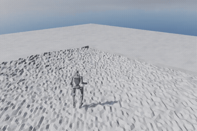](usage_assets/playback.html#video-first-result)

## 0. 验收层级

| 层级 | 通过条件 | 能说明什么 |
| --- | --- | --- |
| 镜像与注册 | 镜像内包版本正确，Isaac 启动，列出全部 6 个任务 ID | 环境安装与入口可用 |
| 场景 smoke | 实际构造、reset、执行固定步数，状态与奖励有限，报告正常退出 | 机器人、场景和 MDP 可以运行 |
| 训练 smoke | 完成 rollout、PPO 更新，写出有效 checkpoint 和实际参数 | 优化与保存链路可用 |
| checkpoint rollout | 匹配的真实权重在固定 seed / 地形 / 难度下运行完整试次 | 该权重在这些条件下的实际表现 |
| 任务达成 | 依据目标距离、episode termination 和试次定义统计 | 该次 rollout 是否完成目标 |
| 完整训练 | 达到指定迭代并保存产物，另做匹配 checkpoint 的独立评估 | 本次训练按计划完成及其评估结果 |

不能把注册成功当作 student 已能运行，不能把两次 PPO 更新当作训练收敛，也不能把视频正常生成当作越障成功。重复录制同一个试次的不同视角只算一次实验。每段视频应保留 task、terrain、difficulty、seed、checkpoint 来源、步数、最终目标距离、提前终止及文件哈希。

最终新训练权重将额外使用 `verify.py --first_episode`：在物理步后、自动 reset 前只读采样第一次回合，分别记录位置到达、位置与朝向同时到达、早停、超时和未完成回合。严格指标定义为首次回合以 timeout 结束、无 early termination、终点位置误差 <0.5 m 且 wrapped heading error 绝对值 <0.5 rad；这是本分支明确选定的评估指标，不是论文 benchmark 成功率。旧报告的 `reached_goal` 仍表示整个有界 rollout 中曾到达，可能跨自动 reset，二者不可混用。

## 1. 全部机器人与任务入口

本项目只发布了 **Unitree G1**，没有飞机。G1 模型位于 `ame2/ame2/assets/g1_lidar/`；普通 teacher 与 gaze teacher 共用物理环境，actor 编码结构不同。

| 注册 ID | actor / 用途 | 公开依赖 | 本分支验收 |
| --- | --- | --- | --- |
| `Ame2-G1` | AME-2 dense attention teacher 训练 | 齐全 | 16 地形构造 / reset / 32 步通过；训练另列 |
| `Ame2-G1-Play` | 普通 teacher 推理 | 需要同结构训练 checkpoint | 16 地形构造 / reset / 32 步通过；新训练权重另列 |
| `Ame2-G1-Gaze` | TAGA 风格 active gaze teacher 训练 | 齐全 | 16 地形构造 / reset / 32 步通过；训练另列 |
| `Ame2-G1-Gaze-Play` | gaze teacher 推理、官方 checkpoint | 齐全 | 16 地形 smoke、官方 native / JIT 各 800 步通过 |
| `Ame2-G1-Gaze-Student` | LSIO，teacher 蒸馏 + RL | 缺 neural mapping 权重 | 上游依赖未发布 |
| `Ame2-G1-Gaze-Student-Play` | student 推理、LiDAR/map 可视化 | 缺 neural mapping / student 权重 | 上游依赖未发布 |

容器内运行注册检查：

```bash
/isaac-sim/python.sh scripts/list_envs.py
```

G1 teacher 的 actor 观察 `teacher_mapping` 和 `teacher_prop`，critic 使用额外的 privileged 状态。实测单环境张量为 `teacher_mapping (1,26,15,3)`、`teacher_prop (1,82)`、`critic (1,499)`，动作维数 23。普通 AME-2 直接处理地图 attention；gaze 先生成全局上下文并选取 12 × 10 地图 crop，再做 dense attention。每个控制步长 0.02 秒，默认 episode 16 秒；动作是所有关节的 delayed position target。默认上身、足部 shaping 在源码中有权重，上游注明尚未专门调优。

## 2. 全部 16 种地形

`play.py --terrain` 从完整训练 generator 重新选地形，不受默认 Play 只选择 `stones` 的限制。训练权重为 0 的四种地形也需要显式验证；“未参与默认采样”和“没有场景代码”是不同情况。

| CLI 名称 | 场景 | 默认训练比例 | 本分支场景 / 官方策略记录 |
| --- | --- | ---: | --- |
| `rough` | 坡度、起伏与粗糙地面 | 0.05 | 进入目标半径，最小 0.097 m；[MP4](usage_assets/animations/terrains-rough-result.mp4) |
| `stair_down` | 下行金字塔台阶 | 0.05 | 进入目标半径，最小 0.141 m；[MP4](usage_assets/animations/terrains-stair_down-result.mp4) |
| `stair_up` | 上行金字塔台阶 | 0.05 | 进入目标半径，最小 0.017 m；[MP4](usage_assets/animations/terrains-stair_up-result.mp4) |
| `boxes` | 方箱障碍 | 0.05 | 进入目标半径，最小 0.053 m；[MP4](usage_assets/animations/terrains-boxes-result.mp4) |
| `obstacles` | 稀疏高障碍与起伏 | 0.05 | 进入目标半径，最小 0.195 m；[MP4](usage_assets/animations/terrains-obstacles-result.mp4) |
| `climb_up` | 上爬高台 | 0.20 | 进入目标半径，最小 0.084 m；[MP4](usage_assets/animations/terrains-climb_up-result.mp4) |
| `climb_down` | 下落高台 | 0.05 | 进入目标半径，最小 0.091 m；[MP4](usage_assets/animations/terrains-climb_down-result.mp4) |
| `consecutive` | 连续高台 | 0.05 | 进入目标半径，最小 0.079 m；[MP4](usage_assets/animations/terrains-consecutive-result.mp4) |
| `gap` | 裂隙 | 0.05 | 进入目标半径，最小 0.101 m；[MP4](usage_assets/animations/terrains-gap-result.mp4) |
| `pallets` | 托盘阵列 | 0.05 | 进入目标半径，最小 0.112 m；[MP4](usage_assets/animations/terrains-pallets-result.mp4) |
| `beam` | 平衡梁 | 0.05 | 进入目标半径，最小 0.064 m；[MP4](usage_assets/animations/terrains-beam-result.mp4) |
| `stones` | 石块踏点 | 0.30 | 进入目标半径，最小 0.084 m；[MP4](usage_assets/animations/terrains-stones-result.mp4) |
| `pit` | 凹坑 | 0 | 进入目标半径，最小 0.090 m；[MP4](usage_assets/animations/terrains-pit-result.mp4) |
| `peak` | 凸峰 | 0 | 进入目标半径，最小 0.096 m；[MP4](usage_assets/animations/terrains-peak-result.mp4) |
| `test_1` | 圆柱踏石混合测试 | 0 | 进入目标半径，最小 0.284 m；[MP4](usage_assets/animations/terrains-test_1-result.mp4) |
| `test_2` | 稀疏混合攀爬测试 | 0 | 进入目标半径，最小 0.124 m；[MP4](usage_assets/animations/terrains-test_2-result.mp4) |

比例配置总和为 1.10，Isaac Lab generator 根据相对权重归一化采样。原始定义见 [terrains.py](ame2/ame2/tasks/terrains.py) 和 [custom_terrains.py](ame2/ame2/tasks/custom_terrains.py)。默认完整训练地形为 10 行 × 60 列，每 tile 12 m × 12 m；Play 为 2 × 2。

上表录像均为官方 gaze checkpoint、difficulty **0.35**、seed **42**、1 个环境、800 步 / 16 s 的独立试次，16 段均无提前终止，结束时各触发 1 次正常 episode timeout。它们覆盖全部场景类型，不能代替跨难度、多 seed 的泛化成功率。完整机器报告在 `terrains/<地形>/result.json`，17 项 suite（含 attention）全部通过。

| rough | stair_down | stair_up | boxes |
| --- | --- | --- | --- |
| [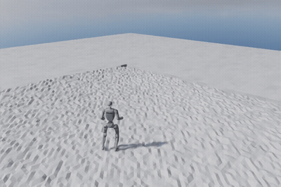](usage_assets/playback.html#terrains-rough-result) | [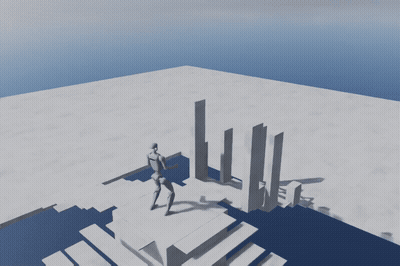](usage_assets/playback.html#terrains-stair_down-result) | [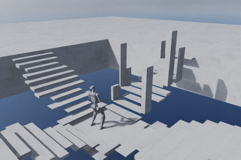](usage_assets/playback.html#terrains-stair_up-result) | [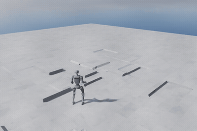](usage_assets/playback.html#terrains-boxes-result) |
| obstacles | climb_up | climb_down | consecutive |
| [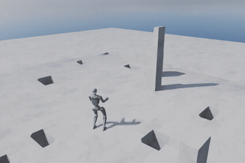](usage_assets/playback.html#terrains-obstacles-result) | [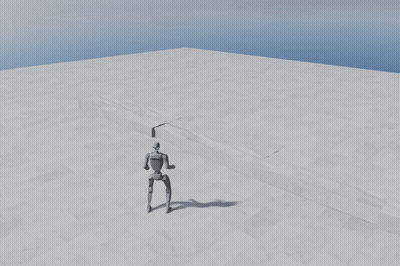](usage_assets/playback.html#terrains-climb_up-result) | [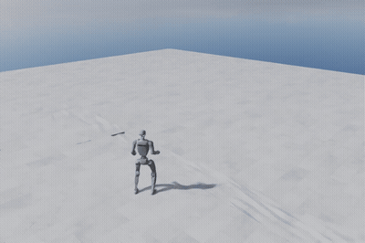](usage_assets/playback.html#terrains-climb_down-result) | [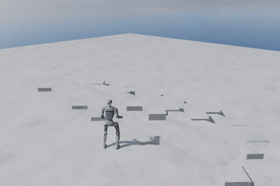](usage_assets/playback.html#terrains-consecutive-result) |
| gap | pallets | beam | stones |
| [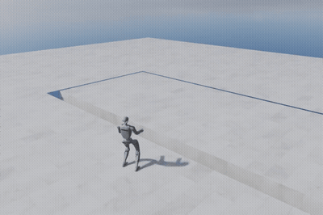](usage_assets/playback.html#terrains-gap-result) | [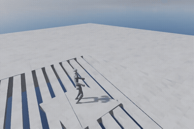](usage_assets/playback.html#terrains-pallets-result) | [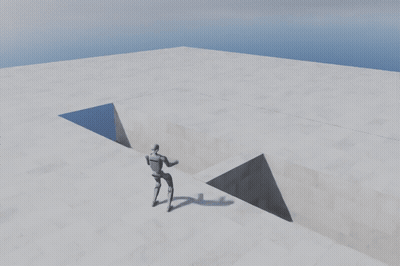](usage_assets/playback.html#terrains-beam-result) | [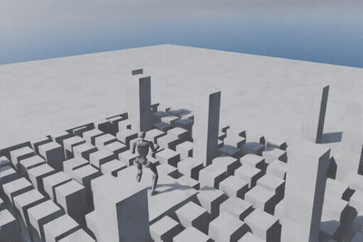](usage_assets/playback.html#terrains-stones-result) |
| pit | peak | test_1 | test_2 |
| [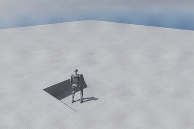](usage_assets/playback.html#terrains-pit-result) | [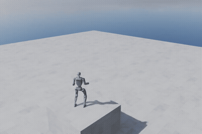](usage_assets/playback.html#terrains-peak-result) | [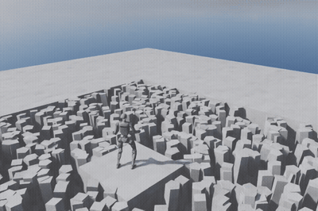](usage_assets/playback.html#terrains-test_1-result) | [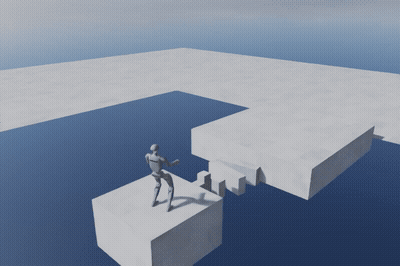](usage_assets/playback.html#terrains-test_2-result) |

### 2.1 单地形运行与独立试次

下列示例在容器内执行。checkpoint 保持只读；每个地形使用独立报告目录，避免覆盖前一个视频：

```bash
/isaac-sim/python.sh scripts/research/verify.py \
  --task Ame2-G1-Gaze-Play --num_envs 1 --seed 42 --headless \
  --checkpoint ../modelzoo/g1_gaze_64000env_10h/model_2400.pt \
  --terrain stones --difficulty 0.35 --video --steps 800 \
  --report ../outputs/research/manual-stones-seed42/result.json
```

替换 `--terrain` 并为其建立独立日志目录，即可逐项复现上表。`--difficulty d` 将 difficulty range 固定为 `(d, d)`；不同地形对难度的几何解释不同。原始 `play.py` 另支持 `--terrain_height 0.3` 固定 `climb_up` 或 `climb_down` 高度，以及 `--goal_x_range 2.6 5.5` 调整目标在 tile 中的采样区间，需要同时指定 `--terrain`。将目标放在障碍另一侧才能检验越障，不应把障碍前的短距离到达称作跨越成功。

默认 `play.py` 的 `[PLAY_RESULT]` 记录 env 0 在整段录像中是否进入 0.5 m 目标半径以及是否提前终止。这个指标是单次录像的结果，不能代替多 seed、多 episode 的论文成功率；超过一个 episode 的长视频还可能包含重置后的轨迹，应保留 episode 级报告。

### 2.2 全量矩阵

研究脚本遍历真实 registry 与完整 terrain dictionary，写出每项的参数、退出状态、有限值检查与完整日志。容器内执行以下命令；输出目录必须不存在或为空，脚本拒绝覆盖已有证据：

```bash
/isaac-sim/python.sh scripts/research/run_suite.py \
  --phase tasks --output ../outputs/research/new-trial/tasks --steps 800
/isaac-sim/python.sh scripts/research/run_suite.py \
  --phase terrains --output ../outputs/research/new-trial/terrains --steps 800
```

`tasks` 检查四个 teacher ID、native/JIT 官方策略在 16 个地形并行运行，以及独立 raw Mid360 raycast。`terrains` 为 16 个地形分别录制 env 0 的完整 800 步视频，再录制 attention。全地形并行报告和单地形录像分别保留；一段 env 0 视频不代表其他 15 个环境的可见过程。

只需检查全部地形时可以在同一个 Isaac App 中执行：

```bash
/isaac-sim/python.sh scripts/research/verify.py --headless \
  --task Ame2-G1-Gaze-Play --terrain all --num_envs 16 --steps 800 \
  --checkpoint ../modelzoo/g1_gaze_64000env_10h/model_2400.pt --export_jit \
  --report ../outputs/research/new-trial/all-terrains.json
```

`--policy zero`、`random`、`native` 或 `jit` 明确策略路径；不传 checkpoint 默认 zero。JIT 路径先比较 native/exported actions，再实际执行 JIT rollout。`--mid360` 为 teacher 环境单独增加 raw LiDAR，避免把缺失 neural mapping 权重误当作原始 raycast 缺失。

2026-10-10 的 `tasks-final/summary.json` 共 8 项全部通过。四个 teacher ID 各在全部 16 种地形执行 32 步随机动作；官方 native 和 JIT 各执行 800 步，观测、动作、奖励和机器人状态均有限，JIT 动作比较最大绝对误差为 `4.77e-7`。Native 的 16 个环境都曾进入目标半径，其中 `test_1` 发生 1 次提前终止；JIT 的 `peak` 与 `test_1` 各发生 1 次。环境会自动 reset，因此这些记录不能写作“16/16 无跌倒”或论文成功率。逐环境数值与原始报告哈希保存在[验收快照](usage_assets/validation_snapshot.json)。

新增首回合统计已实测：同一发布 checkpoint、seed42、difficulty0.5、全部16地形、native800步，**15/16** 在首回合 timeout 时同时满足位置/朝向阈值且未早停；`test_1` 在第283步（5.66s）早停，终止前距离1.686m，因此判失败。其他15项均完整运行800步；JIT parity 最大误差仍为 `4.77e-7`。[首回合原始报告](usage_assets/diagnostics/first_episode_official.json)、[源码与报告SHA](usage_assets/diagnostics/first_episode_provenance.json)。这是固定条件的单次 baseline，不是多seed成功率。

统计实现另经7项Docker CPU测试和短训权重的真实800步检查：短训模型首回合16/16早停、严格成功0；整段rollout累计206次早停，证明新统计不会把多回合混为一次。[短训统计报告](usage_assets/diagnostics/first_episode_short_train.json)。最终评估入口的[未完成训练拒绝记录](usage_assets/diagnostics/final_eval_unfinished_guard.json)和[子进程超时/中断回收检查](usage_assets/diagnostics/final_eval_process_contract.json)也已保存；这些检查不代表云端5000次训练已完成。

## 3. 两种 teacher 训练

容器内分别执行短训练，检查普通 actor 与 gaze actor 两条路径：

```bash
/isaac-sim/python.sh scripts/rsl_rl/train.py \
  --task Ame2-G1 --headless --num_envs 64 --max_iterations 2 \
  --seed 42 --logger tensorboard --run_name smoke-ame2
/isaac-sim/python.sh scripts/rsl_rl/train.py \
  --task Ame2-G1-Gaze --headless --num_envs 64 --max_iterations 2 \
  --seed 42 --logger tensorboard --run_name smoke-gaze
```

两个输出目录分别为 `logs/rsl_rl/ame2/` 和 `logs/rsl_rl/ame2_gaze/`。验收应检查保存的 checkpoint、actor 参数与 optimizer state 均有限，随后用匹配的 `-Play` task 加载新权重完成有界 rollout。2 iterations 的新策略通常不能稳定走路；它只用于确认训练端到端可执行。

| 功能 | 配置位置 / 命令 | 验收证据 |
| --- | --- | --- |
| AME-2 teacher / 32 attention heads | `Ame2-G1` | 两种优化器各 3 次真实更新通过 |
| Gaze teacher / crop / ROI penalty | `Ame2-G1-Gaze`，默认 crop 12 × 10、roi 0.01 | 两种优化器各 3 次真实更新通过 |
| 多 critic heads | 每个 reward 项独立 value head，当前共 23 个；critic 为 16 experts `MoEModel` | 4 组合实测 23 heads；单 head 对照另做 2 次更新通过 |
| Muon optimizer | `agent.algorithm.optimizer=muon`（默认） | 两 actor checkpoint / optimizer / loss 审计通过 |
| bf16 前向更新 | `agent.algorithm.use_mixed_precision=True`（默认） | 两 actor 短训更新通过 |
| Adam / fp32 覆盖 | `agent.algorithm.optimizer=adam agent.algorithm.use_mixed_precision=False` | 两 actor 短训更新通过 |
| symmetry augmentation | 默认仅 critic 数据增强 | 在上述默认短训中执行；不是独立效果消融 |
| 地形 / 目标 / 观测噪声 curriculum | 默认 teacher training env | 短训产生实际 curriculum 日志；不代表完整训练课程已走完 |
| torso / arm / foot shaping | 默认 reward 配置及覆盖 | 默认 shaping 在短训中产生奖励日志；权重效果未做消融 |
| checkpoint 保存与恢复 | `--resume --load_run ... --checkpoint ...` | 从本次 gaze Muon iteration 2 恢复，实际更新 3、4；审计通过 |
| 多 GPU | 两 rank、每 worker 64 env、合计 128 env | 兼容配置各 3 次更新通过；默认通信基线首次 stall，详情见下文 |
| 云端完整默认训练 | 4096 env / 5000 iterations / 最小空闲 GPU 2 | 进行中；截至 12:50 CST 完成 96 次更新，尚未完成 5000 次 |

原始 checkpoint 的 64000 环境配置与当前默认 4096 环境配置分别见 note.md 第 4 节。完整训练必须保留实际 YAML、checkpoint iteration、GPU 型号、镜像 ID 与代码版本；“已启动”与“已完成 5000 次更新”应分别标注。

批量训练检查覆盖普通 / gaze teacher 与 Muon+bf16 / Adam+fp32，以及单 value head 对照：

```bash
/isaac-sim/python.sh scripts/research/run_suite.py \
  --phase training --output ../outputs/research/new-trial/training --num_envs 64
```

远端 `cloud_matrix_final` 的 5 个 fresh jobs 全部通过：四种 teacher / optimizer 组合各 64 env、3 次 PPO 更新，单 value head 为 64 env、2 次更新。保存后的 checkpoint、optimizer state 与 TensorBoard loss 全部有限，actor 和 critic 参数相对首个 checkpoint 均有实际变化；保存配置与预期参数一致。第一次 `cloud_matrix` 的单 head 配置失败另行保留，修复后才建立这个新目录重新执行。

下图直接读取这次云端训练的 TensorBoard event 与 checkpoint audit。曲线只有 3 次更新，用于检查优化链路；损失尺度和参数变化大小不能用于评价哪种算法更好，也没有收敛含义。[精确数据与输入文件哈希](usage_assets/diagnostics/provenance.json)。

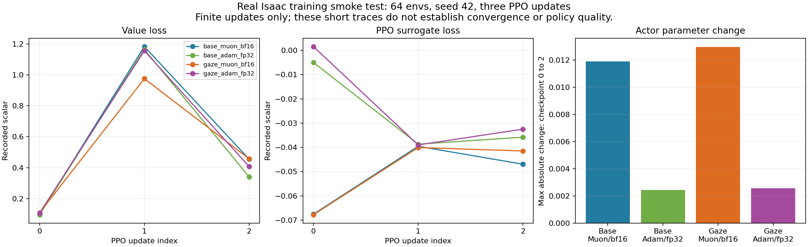

`cloud_resume` 加载上述 gaze Muon `model_2.pt`，保留 optimizer state，从 iteration 3 开始追加两次更新，最终为 `model_4.pt`，实际报告与 checkpoint / loss 审计均通过。`cloud_benchmark` 另用完整默认 600 个地形 tile、4096 环境、Muon+bf16 和 23 critic heads 执行 10 次更新至 `model_9.pt`，同样通过保存与有限值审计。GPU 2 峰值显存 **19,752 MiB（约 19.29 GiB）**，超过本地 16 GiB，因此将这个规模安排在云端。该试次训练循环约 82.16 s，总墙钟 132.76 s；这些是短训实测，5000 次完整训练需单独等待和验收。

新训练普通 teacher 的 `model_2.pt` 已回传本地，由 `Ame2-G1-Play` 在 16 地形 native 推理 64 步，状态有限、导出 JIT 动作误差为 0。这个仅训练 3 次更新的策略在 16 个环境中仅 1 个曾进入目标半径，累计 14 次提前终止；它验证保存 / 回传 / 再加载链路，行走质量尚未训练出来。

正式默认规模的 5000 次训练已在云端 **GPU 2**、最终 6333 镜像的 `ame2-cloud-research` 容器中运行。按 [2026-10-10 12:50:45 CST 的进度快照](usage_assets/diagnostics/full_progress.json)，已完成 iteration 0–95（96 次更新），已保存初始 `model_0.pt`，checkpoint 与当前 loss 有限；**完整训练尚未完成**。运行目录为 `research_official_full/2026-10-10_04-38-09_full`；按当时吞吐估计约 22:04 CST 结束，实际时间和最终结果需继续核验。

该次长期任务由 `docker exec` 启动，查看持久化文件日志，而非常驻容器的 `docker logs`：

```bash
ssh -o BatchMode=yes -p 22 tencent-231 \
  'tail -n 80 /diff/dzp_is_sb/ame2-research/outputs/research/reproduce-20261010/cloud_full/driver.log'
./container/cloud.sh pull
```

完整验收需训练结束、iteration 4999 checkpoint 与配置一致、最终 checkpoint / event 审计通过，再做独立策略评估。进行中的初始化报告不用于判定已完成或训练失败。

最终评估入口会用 `scripts/research/plot_training.py` 从该次事件文件导出训练曲线及完整原始数据；输出包含 loss、奖励、回合长度、课程、策略标准差和吞吐，保留事件文件 SHA256。工具已用真实的 iteration 0–236 快照在 CPU Docker 内[逐点核对](usage_assets/diagnostics/training_curve_tool_validation.json)；请求最终 4999 门槛时，该未完成快照正确失败。独立监控的[18 项 CPU 合同检查](usage_assets/diagnostics/training_monitor_contract.json)涵盖缺 checkpoint、错误配置、缺 loss、记录不足和文件写入竞态。工具验证通过与完整训练完成分别记录，最终曲线需要等待原任务结束。

双 GPU 训练的首次默认 NCCL 通信试次发生 stall，安全结束后保留为失败记录。随后在本服务器使用 `NCCL_CUMEM_HOST_ENABLE=0`、`NCCL_P2P_DISABLE=1`、`NCCL_IB_DISABLE=1`、`NCCL_SOCKET_IFNAME=lo` 的兼容组合重新执行，并记录 NCCL INFO / INIT,GRAPH,ENV 日志；两个 rank 的 `world_size=2`、每卡 64 env、各完成 3 次更新到 iteration 2，共用同一运行目录，退出码、checkpoint / optimizer / loss / 参数变化审计均通过。该组合实际可用，尚未隔离其中哪一项解决了通信问题；用 `AME2_NCCL_COMPAT=1` 复现，完整命令见 note.md。变量定义可查 [NVIDIA NCCL 官方手册](https://docs.nvidia.com/deeplearning/nccl/user-guide/docs/env.html)。

## 4. 推理、导出和诊断功能

以下命令在容器内使用只读官方权重；固定 1 个环境和 seed 42。新增 `--output_dir` 为每项指定独立可写目录。批量执行本节原始 CLI 功能可使用：

```bash
/isaac-sim/python.sh scripts/research/run_suite.py \
  --phase cli --output ../outputs/research/new-trial/cli --steps 800
```

### 4.1 Attention、纯净画面与 TorchScript

```bash
/isaac-sim/python.sh scripts/rsl_rl/play.py \
  --task Ame2-G1-Gaze-Play --num_envs 1 --headless --seed 42 \
  --checkpoint ../modelzoo/g1_gaze_64000env_10h/model_2400.pt \
  --output_dir ../outputs/research/manual-attention \
  --terrain rough --difficulty 0.3 --video --video_length 800
/isaac-sim/python.sh scripts/rsl_rl/play.py \
  --task Ame2-G1-Gaze-Play --num_envs 1 --headless --seed 42 \
  --checkpoint ../modelzoo/g1_gaze_64000env_10h/model_2400.pt \
  --output_dir ../outputs/research/manual-export \
  --terrain rough --difficulty 0.3 --export --video --video_length 800 --no_markers
```

第一段显示 actor/critic 高度扫描与 attention；第二段关闭 overlay 并导出 `ame2_exported_2400.jit`，随后重新加载该 JIT 执行 rollout。标准 gaze export 返回 actions、crop attention latent、global context。导出成功还应检查重新加载后的动作数值；普通 AME-2 同样有 JIT 入口，ONNX 在当前模型代码中明确未实现。

下面是实际 `verify.py --attention` 的 `climb_up` 400 步录像：蓝色到红色表示本帧相对 attention 由低到高，颜色每帧归一化。该片段使用官方权重，最小目标距离 0.081 m，无提前终止。

[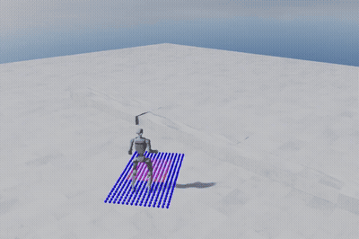](usage_assets/playback.html#terrains-attention-result)

原始 `play.py --export --no_markers` 也已独立执行：`rough`、difficulty 0.35、seed 42、800 步，导出后重新加载 JIT 录制完整片段，期间进入目标半径且无提前终止。[查看无 overlay 的 JIT 录像](usage_assets/playback.html#cli-play_export_video-play_result)。

### 4.2 奖励、关节与加速度

```bash
/isaac-sim/python.sh scripts/rsl_rl/play.py \
  --task Ame2-G1-Gaze-Play --num_envs 1 --headless --seed 42 \
  --checkpoint ../modelzoo/g1_gaze_64000env_10h/model_2400.pt \
  --output_dir ../outputs/research/manual-plots \
  --terrain rough --difficulty 0.3 --plot --log_rewards \
  --video --video_length 810 --no_markers
```

`--plot` 在仿真时间到 10 s 后保存 `debug_plots.pdf`，包含 body frame 基座速度和各关节 torque–velocity 图。`--log_rewards` 在 env 0 首次结束时保存 `reward_curves.pdf`，记录全部 active reward 项及累计贡献；16 秒 episode 需要运行到终止，提前跌倒则记录其实际短 episode。`--vizacc` 的 WebAgg 实时图需要 GUI，headless 跳过不能计为 GUI 验收。

已在 `rough`、difficulty 0.35、seed 42 下实际执行 850 步 / 17 s，原始 CLI 正常退出并写出[基座速度与关节诊断 PDF](usage_assets/diagnostics/debug_plots.pdf)和[逐项奖励曲线 PDF](usage_assets/diagnostics/reward_curves.pdf)。文件直接复制自该次 Isaac 仿真产物，来源哈希见[诊断来源清单](usage_assets/diagnostics/provenance.json)。

本地 X11 GUI 的 `--vizacc` 已另行实测。WebAgg 采集连接实际运行的 plotter，收到 158 张不同的 WebSocket PNG 及 16 张不同的完整曲线；下图是最后一张真实渲染结果。它证明 GUI 曲线在更新，采集器没有独立解析原始传感器数值。

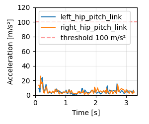

默认 Fabric 的 X11 GUI 已另做 1000 步实测，下图可见 G1 与实际地形。该截图来自 `gui-fabric`，与只显示地面的 `--disable_fabric` 早期试次分别保留。

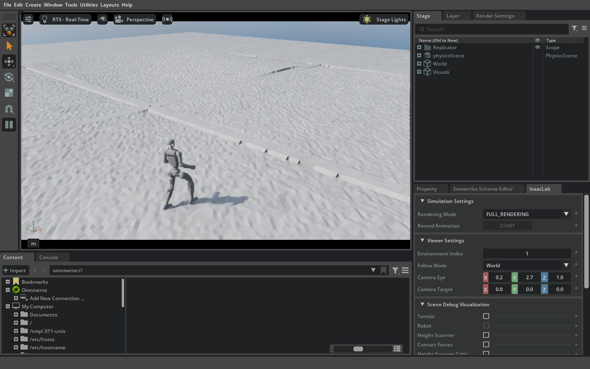

### 4.3 往返与外力飞行调试

```bash
/isaac-sim/python.sh scripts/rsl_rl/play.py \
  --task Ame2-G1-Gaze-Play --num_envs 1 --headless --seed 42 \
  --checkpoint ../modelzoo/g1_gaze_64000env_10h/model_2400.pt \
  --output_dir ../outputs/research/manual-return-home \
  --terrain rough --difficulty 0.1 --return_home --video --video_length 800
/isaac-sim/python.sh scripts/rsl_rl/play.py \
  --task Ame2-G1-Gaze-Play --num_envs 1 --headless --seed 42 \
  --checkpoint ../modelzoo/g1_gaze_64000env_10h/model_2400.pt \
  --output_dir ../outputs/research/manual-fly \
  --terrain climb_up --difficulty 0.3 --fly --video --video_length 800
```

`--return_home` 达到目标 0.5 m 内并停留 1 s 后，先转向出生点，再重定向回程。teacher 路径能检查命令状态机，但不会验证尚未发布的 neural map memory。`--fly` 对 G1 base 施加外力和力矩，并清零策略动作，用于调试地形与感知；这不是飞行器模型，也不能作为机器人自主越障的成功证据。

本次往返试次为 `climb_up`、height 0.25 m、goal x range [3,4]、difficulty 0.2、1600 步 / 32 s；日志中“到达后转向出生点”和“面向出生点后开始回程”各触发两次，整段无提前终止。[查看往返录像](usage_assets/playback.html#cli-return_home_height_goal-play_result)。这证明两个状态分支实际运行，报告没有单独统计回到出生点的成功率。

`--fly` 在 `pit`、difficulty 0.35 下实际执行 500 步 / 10 s；外力调试入口正常结束，该段**未进入目标半径且发生提前终止**。[查看外力辅助调试录像](usage_assets/playback.html#cli-fly_assistance-play_result)。该项的 CLI 验收通过只表示入口可执行。

### 4.4 其他入口

`scripts/zero_agent.py` 和 `scripts/random_agent.py` 分别发送零动作与随机动作，适合观察环境基本行为，默认持续运行。本分支为这两个原始入口加入 `--max_steps`；0 保持默认无限运行，正数在指定步数后正常退出：

```bash
/isaac-sim/python.sh scripts/zero_agent.py \
  --task Ame2-G1-Play --num_envs 1 --headless --max_steps 32
/isaac-sim/python.sh scripts/random_agent.py \
  --task Ame2-G1-Play --num_envs 1 --headless --max_steps 32
/isaac-sim/python.sh scripts/list_envs.py --keyword Gaze
```

研究验收使用有步数上限的入口并明确正常退出，避免用外部 timeout 掩盖初始化失败。

`--real-time` 尝试让每个仿真步等待到真实时间周期，硬件较慢时仍会落后。`--disable_fabric` 使用 USD I/O 调试路径，GPU 仿真禁用 Fabric 后 renderer 不能更新几何；本次该入口物理执行与曲线更新已观察到，但只有地面的 GUI 截图不能算可见 G1 验收。GUI 和录像使用默认 Fabric，官方限制见 note.md 第 3 节。

`--use_pretrained_checkpoint` 查询 Isaac Lab 官方模型 registry，本项目的自定义任务应明确使用仓库 `modelzoo` 路径。训练入口还支持 `--video`、`--video_length`、`--video_interval` 和 manager-based 环境的 `--export_io_descriptors`。这些额外入口是否已经实际执行，以验收表与对应报告为准；帮助信息存在本身不是验收。

训练录像与 I/O descriptor 已在本地实际执行，64 env / 2 次更新，录制 32 帧，并输出[真实 I/O descriptors](usage_assets/diagnostics/IO_descriptors.yaml)：

```bash
/isaac-sim/python.sh scripts/rsl_rl/train.py --headless \
  --task Ame2-G1-Gaze --num_envs 64 --max_iterations 2 --seed 42 \
  --logger tensorboard --experiment_name research_extras --run_name video-io-new-trial \
  --video --video_length 32 --video_interval 10000 --export_io_descriptors \
  agent.save_interval=1 env.viewer.origin_type=asset_root env.viewer.asset_name=robot \
  'env.viewer.eye=[-3.2,-4.0,2.6]' 'env.viewer.lookat=[1.0,0.0,0.4]'
```

[查看训练中的真实短片](usage_assets/playback.html#extras-train_video_io-train_result)。它记录持续更新的随机训练策略，不能当作最终 checkpoint 的独立策略评估。

## 5. 未发布依赖的核验

| 项目 | 已有内容 | 缺失内容 | 当前可复现结论 |
| --- | --- | --- | --- |
| Mid360 raw LiDAR | raycaster、扫描模式与 robot sensor USD | student 完整环境受 neural map 初始化阻挡 | 独立 raw raycast 已通过；不能记作 neural mapping 复现 |
| Neural mapping | pipeline / sensor / visualization 源码 | `g1LivoxMapping_perframe.pt` | 完整闭环不可执行 |
| LSIO student | actor、imitation+representation+RL 代码与配置 | neural mapping checkpoint，现成 student checkpoint | 完整训练/推理不可执行 |
| Teacher JIT | 官方 gaze checkpoint + exporter | 本分支实际导出生成 | native 数值比较与全 16 地形 JIT rollout 已通过 |
| Tron1 / depth map | 上游 release plan | 环境、资产与模型 | 尚未发布 |
| Neural map training | 上游 release plan | 训练代码与训练数据 | 尚未发布 |

teacher JIT 路径与 mapping checkpoint 路径见 note.md 第 7 节。核验 missing-dependency 路径时应保留明确缺失文件错误；不要把它统计成项目已有功能正常运行，也不要把预期失败隐藏在一个全部通过的数量里。

## 6. 图文、视频与复现实验记录

本分支已保留 **22 段真实 Isaac Sim 录像**：16 种地形、attention、首轮 rough、3 段原始 play 功能录像，以及 1 段短训练录像。原始 MP4 与大日志保存在实验目录，仓库包含完整时长压缩 MP4、GIF、poster 和机器可读来源清单。离线播放器分别展示进入目标半径、未到达、提前终止和目标指标未记录，支持播放、暂停、拖动与调速；未发布依赖的边界见第 5 节。

在容器内从真实报告导出图文资产；导出使用镜像内 ffmpeg，不启动 Isaac Sim：

```bash
/isaac-sim/python.sh ../usage_assets/export.py \
  --report-root ../outputs/research/reproduce-20261010 \
  --output ../usage_assets --gif
/isaac-sim/python.sh ../usage_assets/export_analysis.py \
  --report-root ../outputs/research/reproduce-20261010 \
  --output ../usage_assets
```

`manifest.json` 保留 source MP4、原始 JSON、压缩 MP4、poster 和 GIF 的 SHA-256；`manifest.js` 让离线 HTML 可以直接读取清单，无需宿主机 Python HTTP 服务。压缩 MP4 保留完整原始时长，GIF 对整段均匀采样 48 帧并统一约 6 s 循环：长片加速、短片慢放，不用于计时。

离线播放器已用独立 Chrome profile、CPU CDP 客户端实际验证 10 项交互：`file://` 清单与 22 张视频卡加载、地形筛选、结果筛选、MP4 metadata、播放时间推进、暂停、seek、2× 调速、暂停全部、清除筛选。实测 1× 下约 0.651 s 墙钟推进 0.651 s，2× 下约 0.651 s 墙钟推进 1.301 s，seek 准确到 9.6 s。[真实浏览器报告](usage_assets/diagnostics/browser_result.json)由 `usage_assets/check_browser.py` 生成；测试后独立浏览器、端口和 profile 已清理。

按已生成的真实报告更新验收表：

| 检查项 | 结果 | 原始证据 / 复现命令 |
| --- | --- | --- |
| 本地单镜像构建与版本 | 通过 | 本地 `ame2:research`；Python 3.11.13、Torch 2.7.0+cu128、Isaac Lab VERSION 2.3.2 |
| 6333 镜像内固定源码独立运行 | 无源码 bind 的 CPU / GPU 检查通过 | 两 actor CPU JIT 回归；官方权重 GPU 32 步 / JIT 比较误差 0 |
| 六个任务注册 | 通过 | runtime registry；两个 student 单列未发布依赖 |
| 四个 teacher ID reset / step | 通过 | `tasks-final`：每 ID 16 地形 × 32 步 |
| 全部 16 个地形 | 并行场景与逐地形视频通过 | 16 段各 800 步；另有 attention 400 步 |
| 官方 gaze checkpoint 16 地形 rollout | native / JIT 执行通过，提前终止如实记录 | 两路径各 800 步；不是 16/16 无跌倒 |
| 两种 actor / 两优化器训练与保存 | 云端 5/5 通过 | 第 3 节；新权重独立推理另列 |
| checkpoint 恢复与追加更新 | 通过 | `cloud_resume`：加载 2 → 更新 3、4 |
| 官方默认规模短训 | 通过 | `cloud_benchmark`：4096 env / 600 tiles / 10 更新 |
| 双 GPU DDP | 兼容组合通过；默认基线 stall 失败保留 | `cloud_ddp_compat`：2 ranks × 64 env，各 3 更新至 iteration 2 |
| 新训练普通 teacher checkpoint 独立推理 | 重新加载 / native rollout / JIT 数值比较通过 | `extras/base_trained_jit`，质量不足及提前终止如实记录 |
| 导出 JIT 与独立加载 | 通过 | 全 16 地形 JIT 800 步；两 actor 训练分布初始化后的 CPU 导出回归 |
| 原始 play 导出 / 纯净录像 | 通过 | `cli` 4/4；800 步真实 JIT 录像 |
| 奖励 / 关节诊断 PDF | 通过 | 第 4.2 节两份实际 PDF |
| GUI 实时髋关节加速度 | 真实 WebAgg 渲染通过 | 第 4.2 节，158 张不同 WS PNG / 16 张完整曲线 |
| GUI 默认 Fabric 渲染 | 实际 G1 可见，1000 步通过 | 第 4.2 节真实 X11 截图 |
| 原始 zero / random 入口 | 各 32 步正常退出通过 | `extras`；zero 另覆盖 headless USD I/O |
| 训练录像 / I/O descriptors | 64 env / 2 次更新通过 | 第 4.4 节，32 帧短片与真实 YAML |
| 往返状态机 | 两个状态分支实际触发 | 第 4.3 节，32 s 录像与日志 |
| fly 外力调试 | 入口执行通过；该段未到达且提前终止 | 第 4.3 节，不能计自主越障成功 |
| 云端同镜像与代码同步 | 通过 | [6333 config / 36 层 / archive 校验](usage_assets/diagnostics/image_sync.json)；运行时 source SHA 单独记录 |
| 离线视频播放器实际交互 | 10/10 通过 | 上述浏览器报告，非仅控件截图 |
| 云端官方默认训练完成 | 进行中；96/5000 更新，尚未完成 | [截至 12:50 CST 的真实进度](usage_assets/diagnostics/full_progress.json)，实时查看命令见第 3 节 |
| Student / neural mapping / Tron1 | 上游依赖未发布 | 第 5 节 |

[验收快照](usage_assets/validation_snapshot.json)保存采集时间、Docker image ID、GPU、seed、原始报告路径与 SHA-256；suite 的每个 job 记录实际代码文件 SHA。新的实验写入新目录和独立 trial ID，避免把失败重跑覆盖成一次从未失败过的实验。

## 7. 本分支为复现修复的入口

- **容器构建**：修复 NVIDIA 预打包环境中 setuptools / packaging 的兼容性，固定基础镜像 digest；依赖修复只发生在 Docker 层。
- **有界运行与可写产物**：`play.py` 支持 `--max_steps`、`--output_dir` 和 `play_result.json`；官方 checkpoint 保持只读，录像、JIT 和 PDF 写入独立目录。
- **失败报告与退出状态**：验证器在初始化、执行或 cleanup 异常时记录 `passed=false` 并失败退出；suite 同时检查报告与进程状态，避免 Kit 的退出行为把失败伪装成成功。
- **训练配置与恢复**：修复 `--experiment_name` 未实际作用于输出目录，以及绝对 checkpoint 路径的 resume 解析。
- **训练后 JIT 导出**：随机 actor 已创建 `torch.distributions.Normal` 后，旧导出入口错误地调用其不存在的方法。本分支只在分布提供 `as_deterministic_output_module` 时调用它，否则用 `Identity` 输出动作均值；两个 teacher actor 的 script/freeze/重新加载均通过，CPU 合成输入的最大动作误差为 `2.98e-8`。
- **全地形场景**：held-out `test_1/test_2` 原有 10 个 target patches，其他地形 30 个，Isaac Lab 的同名 patch tensor 不能直接拼接。仅在组合验证场景统一为 10 个并写入 `combined_scene_patch_overrides`；单地形录像和默认官方训练保留原参数。
- **真实覆盖**：组合场景使用 generator 的确定性列分配，每种地形一列、难度固定；环境的 terrain-level curriculum 关闭。随机生成 16 列不能保证覆盖 16 种类型，旧随机组合的结果保留为早期试次，不作为逐地形验收。

第一轮失败报告保存在 `outputs/research/reproduce-20261010/tasks/`；最终通过目录及逐项证据以第 6 节验收快照为准。这些修复解决安装与验证入口的可执行性，策略未完成的试次仍按真实结果展示。
